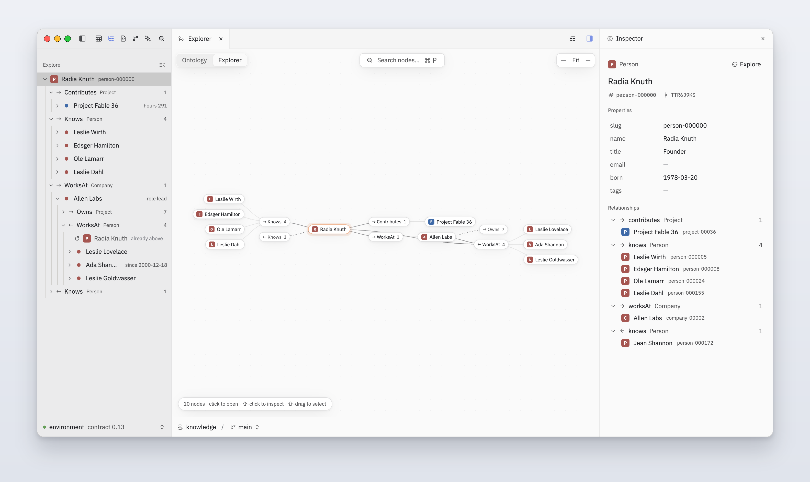

# OmniGraph Studio

A native desktop app for reading, exploring and changing
[OmniGraph](https://github.com/ModernRelay/omnigraph) graphs.



## Why it exists

An OmniGraph graph is typed and versioned: every node and edge type is a table, and every
change is a commit on a branch. The `omnigraph` CLI and the HTTP API can do everything, but
someone working with the data needs to see rows, follow relationships, try a query, fix a
value, and know afterwards what changed and where it went.

Studio is that surface. It shows the graph the way the engine holds it, and it changes the graph
only in ways the engine can account for. It is a native app, built on
[Zed](https://github.com/zed-industries/zed)'s GPUI, so large tables stay fast and the keyboard
reaches everything.

## What you can do

| Job | In Studio |
|---|---|
| Browse | A table per node and edge type, read in pages with counts and filters computed on the server. Sort, group by a property or a relationship, hide and move columns, save views, preview Blob values. |
| Explore | Walk relationships from any node in a tree and on a canvas that share the same walk, group neighbours, and see the schema as a map. |
| Query | A `.gq` editor with highlighting, diagnostics, completion and hover from OmniGraph's own compiler. ⌘↵ runs the query under the cursor. Explain shows the plan; hovering a step highlights the part of the query it runs. |
| Change | Edit a cell and save it, or stage edits across rows and save them together as one mutation. Insert, delete and bulk-set values too. Each edit checks that the value still holds what you read, so a change made elsewhere is caught instead of overwritten. |
| Review and merge | See a branch's changes against its base, row by row, then merge it. If the engine refuses, the conflicts are listed. |
| History | Commits drawn as a lane graph. Any table, query or node can be read at an older commit, read-only. |
| Ask an agent | Claude or Codex, connected over the Agent Client Protocol. The agent writes only to a branch Studio creates for it, through Studio's tools, and never sees your token. |

Also: a command palette, go to any type or node, the schema's source, a storage inspector,
multiple windows restored on launch, and `omnigraph-studio://` links that open a graph, node or
query.

## What it promises

These rules come from the [constitution](.specify/memory/constitution.md) that every change
follows.

- **The server is the authority.** Studio reads and writes only through an OmniGraph server's
  HTTP API. It never opens graph storage and keeps no copy of the data that it treats as true.
- **One commit per view.** Each tab reads one commit and stays on it. When the branch moves, the
  tab says "Newer data · Refresh" instead of changing under you.
- **A write has three outcomes.** Committed, refused (nothing was written), or unknown. Studio
  never retries a write by itself. An unknown outcome is settled by reading history, and your
  draft stays until it is.
- **Every write names its branch.** Destructive actions ask you to type what will be destroyed.
  The server's policy decides what you may do: a refusal shows as a denial and keeps your draft.
- **Nothing moves under you.** A row that no longer matches a filter after an edit stays where it
  is, dimmed, until the table is read again.
- **Keyboard first.** Every command is an action with a key binding. Menus, tooltips and the
  palette are all generated from those actions.
- **Work is bounded.** Every list is virtualized and paged, and every limit says what to do
  instead.

## Get started

You need an OmniGraph **0.13** server, Rust **1.98.1** (installed for you by
`rust-toolchain.toml`) and:

- **macOS:** full Xcode, for the Metal shader compiler.
- **Linux:** the Wayland, X11 and Vulkan development packages (see `.github/workflows/ci.yml`).

```bash
cargo run --release
```

The first build compiles Zed's GPUI crates and needs about 8 GB of disk. On an Apple M5 Pro a
clean release build takes about 10 minutes, a debug build (`cargo run`) under 3.

**Connecting.** Studio picks up the servers and tokens you already use with the `omnigraph` CLI
(`~/.omnigraph/config.yaml` and `credentials`). File → Open Graph… also adds a server by URL. To
open one graph straight away:

```bash
OMNIGRAPH_STUDIO_SERVER=http://127.0.0.1:8787 OMNIGRAPH_STUDIO_TOKEN=<token> OMNIGRAPH_STUDIO_GRAPH=<graph> cargo run --release
```

**Trying it on sample data.** `script/dev-server` serves two small graphs, `knowledge` (200
people, 25 companies, 40 projects) and `notes`, on `127.0.0.1:8787` with the token `dev-token`.
It needs the OmniGraph 0.13 binaries on your `PATH`.

```bash
script/dev-server
```

Then, in a second terminal:

```bash
OMNIGRAPH_STUDIO_SERVER=http://127.0.0.1:8787 OMNIGRAPH_STUDIO_TOKEN=dev-token OMNIGRAPH_STUDIO_GRAPH=knowledge cargo run --release
```

**Packaging.** `script/bundle-mac` builds the app bundle and a DMG; `script/bundle-linux` builds
a tarball with a `.desktop` entry.

### Keys

| Key | Does |
|---|---|
| ⌘K | Command palette |
| ⌘P | Go to a type or a node |
| ⌘N | New query |
| ⌘↵ | Run the query under the cursor |
| ⌘⇧O / ⌘⇧E | Ontology map / graph explorer |
| ⌘⇧B | Switch branch |
| ⌘⇧A | Agent |
| ? | Every shortcut |

## How it's built

- **UI:** Zed's GPUI and UI crates, pinned to one Zed release (`docs/zed-pin.md`). There is
  exactly one `gpui` in the build.
- **Language:** OmniGraph's MIT-licensed `omnigraph-compiler`, linked in-process for parsing and
  type checking. It is the only engine crate Studio links. Tree-sitter grammars for `.gq` and
  `.pg` live in `grammars/`.
- **Layers:** each crate depends only on lower layers, and feature crates never depend on each
  other. `script/check-layers.py` enforces this.

```text
studio (the app)
  ↓ type_table · relationship_tree · graph_canvas · query_editor · review · history · inspectors · agent_panel · command_palette
  ↓ studio_workspace (window, panes, docks)
  ↓ graph_store (sessions, snapshot pins, exploration)
  ↓ graph_client (HTTP) · gq_language (compiler) · studio_ui
  ↓ studio_settings · studio_theme
  ↓ studio_actions
```

`docs/architecture.md` has the data flow and the state model.

## Status

Studio is built against OmniGraph 0.13, with macOS first. Not built yet:

- Windows support, signed releases and auto-update.
- Sign-in through an identity provider (OIDC). Studio uses bearer tokens today.
- Approvals and comments on reviews.
- Features that wait on engine changes, each listed with what Studio does meanwhile in
  [spec 012](specs/012-omnigraph-engine-changes/plan.md).

## Working on Studio

Every feature has a plan in [`specs/`](specs/README.md) that records its design, the
alternatives it rejected, and a log of the checks behind each claim. A change starts with its
plan. The checks CI runs:

```bash
cargo fmt --all --check
cargo clippy --workspace --all-targets -- -D warnings
cargo test --workspace
python3 script/check-layers.py
```

| Path | What |
|---|---|
| `.specify/memory/constitution.md` | The principles every change follows |
| `specs/` | One plan per feature, with its validation log |
| `docs/architecture.md` | Crate layers, data flow, state model, window frame |
| `docs/zed-pin.md` | Which Zed crates Studio uses, and how to move the pin |
| `docs/deferred-engine-changes.md` | OmniGraph changes Studio would use, and what it does today |
| `crates/` | The workspace; `crates/studio` is the app |
| `grammars/` | Tree-sitter grammars for `.gq` and `.pg` |
| `assets/` | Default keymaps and settings |
| `script/` | Dev server, sample data, bundling, the layer check |

## License

GPL-3.0-or-later, because Studio links Zed's GPL-3.0 UI crates; see `LICENSE`. OmniGraph
itself is MIT and unaffected: Studio talks to it over HTTP and links only its MIT-licensed
compiler crate.
