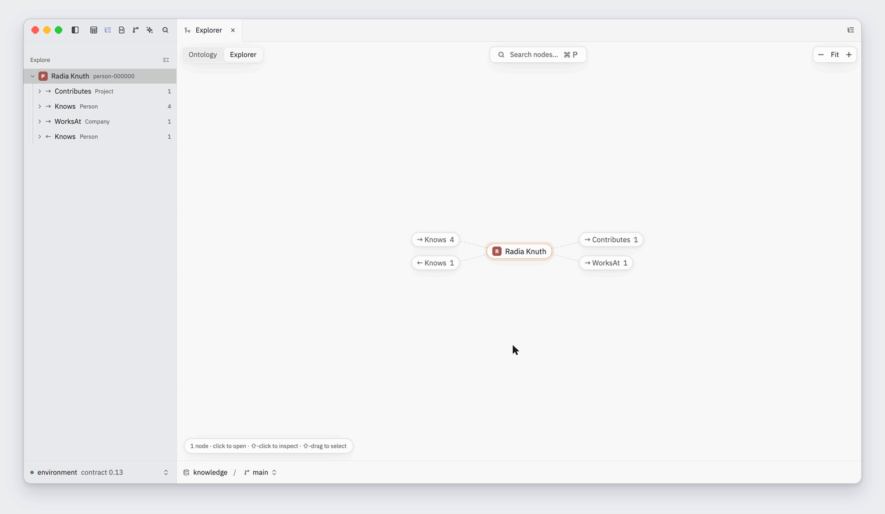

# OmniGraph Studio

A native, GPU-rendered desktop client for
[OmniGraph](https://github.com/ModernRelay/omnigraph) graphs, written in Rust. It connects to
an OmniGraph server over HTTP and provides a table per node and edge type, a relationship
explorer, a GQ query editor with stored queries, branch review and merge, commit history and an
agent panel.

The UI is built on [GPUI](https://github.com/zed-industries/zed/tree/main/crates/gpui), the
Rust UI framework from Zed, with its editor, UI and theme crates. GPUI draws every frame on the
GPU, through Metal on macOS and Vulkan (wgpu) on Linux; there is no web view or browser engine.



## Download

[Releases](https://github.com/ModernRelay/omnigraph-studio/releases) have a macOS DMG (Apple
silicon), Linux tarballs (x86_64, arm64) and a Windows zip (x86_64, Windows 10 1809 or later).
macOS builds are not notarized and the Windows build is not signed yet; the release notes say
how to open them. On Windows the agent panel is not available yet. To build from source
instead, see below.

## Quick start

Requirements:

- Rust 1.98.1, installed by `rust-toolchain.toml`.
- macOS: the Command Line Tools (GPUI compiles its Metal shaders when Studio starts); full
  Xcode to compile them into a release build (`script/bundle-mac`). Linux: the Wayland, X11 and
  Vulkan development packages listed in `.github/workflows/ci.yml`.
- An OmniGraph server that speaks HTTP contract 0.13: 0.13, or 0.14 built from main. For the
  sample graph, its `omnigraph` and `omnigraph-server` binaries on `PATH`.

Run against the sample graph (200 people, 25 companies, 40 projects):

```bash
script/dev-server    # serves knowledge and notes on 127.0.0.1:8787, token dev-token
```

```bash
OMNIGRAPH_STUDIO_SERVER=http://127.0.0.1:8787 OMNIGRAPH_STUDIO_TOKEN=dev-token \
  OMNIGRAPH_STUDIO_GRAPH=knowledge cargo run
```

A clean debug build takes about 2.5 minutes on an Apple M5 Pro and about 8 GB of `target/`; a
release build (`cargo run --release`) about 10 minutes.

Without the environment variables, Studio reads servers and tokens from the `omnigraph` CLI's
`~/.omnigraph/config.yaml` and `credentials`, and File → Open Graph… adds a server by URL.

| Variable | Effect |
|---|---|
| `OMNIGRAPH_STUDIO_SERVER` | Adds a server named `environment` |
| `OMNIGRAPH_STUDIO_TOKEN` | Its bearer token |
| `OMNIGRAPH_STUDIO_GRAPH` | Opens this graph on that server at launch |
| `OMNIGRAPH_STUDIO_BRANCH` | The branch to open (default `main`) |
| `OMNIGRAPH_STUDIO_DATA` | Directory of `settings.json`, `keymap.json` and the session (default `~/Library/Application Support/OmniGraph Studio`, `%APPDATA%\OmniGraph Studio` on Windows, or `$XDG_CONFIG_HOME/omnigraph-studio`) |

Packaging: `script/bundle-mac` builds an app bundle and a DMG, ad hoc signed unless a signing
identity is configured; `script/bundle-linux` builds a tarball with a `.desktop` entry.

## Features

- **Type tables.** One table per node and edge type, read in keyset pages with filters and
  counts evaluated on the server. Sort, filter (including "related to" and "has none" on
  relationships), group by a property or a relationship, hide and reorder columns, saved views,
  Blob metadata and previews. Cell edits, inserts, deletes and bulk set; edits can be staged
  across rows and saved as one mutation.
- **Explorer.** A relationship tree and a canvas that render the same exploration: expand a
  node's relationships, page and group neighbours, show at-most-one edges as fields. The
  ontology view draws the schema's types and relationships.
- **Query editor.** `.gq` files with tree-sitter highlighting, and diagnostics, completion and
  hover from `omnigraph-compiler`. ⌘↵ runs the declaration under the cursor, mutations need a
  confirmation naming the branch, and `explain` plans map each operator back to the query text.
  Saved queries per graph.
- **Branches, review and merge.** Create, switch and delete branches; review a branch's changes
  against its base row by row and revert single changes; merge, with conflicts listed when the
  server refuses.
- **History.** Commit lane graph; open any table, query or node at an older commit, read-only.
- **Agent panel.** Claude or Codex over the Agent Client Protocol, each started as its own
  `npx` process. The agent gets an MCP server proxied by Studio, writes only to a branch Studio
  creates for it, and never receives the token.
- **Shell.** Command palette (⌘K), go to type or node (⌘P), split panes, several windows
  restored on launch, the schema's `.pg` source, a storage inspector, and `omnigraph-studio://`
  links that open a graph, node or query without running anything. `?` lists every binding.
- **Settings and shortcuts.** A settings tab (⌘,) generated from the settings schema, with
  per-graph values. `settings.json` and `keymap.json` (Zed's keymap format, over Studio's
  defaults) may hold comments, are read again when saved, and list every problem by line; a
  change from the tab rewrites only the setting it touches.

## How Studio uses OmniGraph

Studio is a client of the OmniGraph HTTP API and nothing else. These rules are in
`.specify/memory/constitution.md` and each feature plan records how it follows them.

- **HTTP only.** No access to graph storage and no engine crate except `omnigraph-compiler`,
  which is linked for parsing and type checking. Every request sends `omnigraph-http-api: 0.13`,
  and a response without the header is treated as having an unknown effect.
- **One commit per view.** A view records the `graph_commit_id` of its first read and passes it
  as `snapshot` on every later read. When the branch head moves, the view shows "Newer data ·
  Refresh" and keeps its data until refreshed.
- **Bound writes.** A cell edit or bulk set is `update T set { p: $new } where @id = $id and
  p = $old`, so a row changed by someone else is left alone and reported. Row deletes and
  reverts from a review use `POST /mutate/if-graph-commit` with the commit the view read.
- **Three outcomes, no retries.** A write is committed, refused, or unknown (the response was
  lost). Studio never resends a write; an unknown outcome is settled by reading history, and the
  draft is kept until then.
- **Server policy.** Authorization is the server's Cedar policy; Studio enforces no rules of its
  own. A 403 is shown as a refusal and the draft stays.
- **Newer routes on demand.** Routes beyond 0.13 are used only when the server's OpenAPI
  document advertises them. Engine changes Studio would use, and what it does without them, are
  listed in `docs/deferred-engine-changes.md` and [spec 012](specs/012-omnigraph-engine-changes/plan.md).

## Architecture

Studio is a Cargo workspace (Rust 2024 edition) of 20 crates: 18 for the app and 2 for the
tree-sitter grammars. A crate depends only on crates in lower layers, and feature crates never
depend on each other.
`script/check-layers.py` enforces this in CI.

| Layer | Crates |
|---|---|
| 6 | `studio`: the binary, menus, windows, deep links |
| 5 | `type_table`, `relationship_tree`, `graph_canvas`, `query_editor`, `review`, `history`, `inspectors`, `agent_panel`, `command_palette` |
| 4 | `studio_workspace`: panes, tabs, docks, modals, toasts |
| 3 | `graph_store`: connections, graph sessions, snapshot pins, exploration |
| 2 | `graph_client` (HTTP, no GPUI), `gq_language` (compiler wrapper, no GPUI), `studio_ui` |
| 1 | `studio_settings`, `studio_theme` |
| 0 | `studio_actions`: every action type |

GPUI and its crates come from git at one release tag (`docs/zed-pin.md`). The tree-sitter grammars for
`.gq` and `.pg` are in `grammars/`. `docs/architecture.md` describes the data flow and the state
model.

## Development

```bash
cargo fmt --all --check
cargo clippy --workspace --all-targets -- -D warnings
cargo test --workspace
python3 script/check-layers.py
```

These are the checks CI runs on macOS and Linux. `crates/studio/examples/snapshot.rs` renders
Studio offscreen to a PNG while dispatching actions, clicks and keystrokes. It is how UI changes
are checked against the sample graph:

```bash
OMNIGRAPH_STUDIO_SERVER=http://127.0.0.1:8787 OMNIGRAPH_STUDIO_TOKEN=dev-token \
  OMNIGRAPH_STUDIO_GRAPH=knowledge cargo run -p studio --example snapshot -- out.png \
  'studio_graph::OpenType={"type_name":"Person"}'
```

Each feature has a plan in [`specs/`](specs/README.md): the design, the alternatives rejected,
what is deferred, and a dated validation log of the checks behind each claim.

| Path | Contents |
|---|---|
| `.specify/memory/constitution.md` | Principles every change follows |
| `specs/` | One plan per feature |
| `docs/` | Architecture, the GPUI pin, deferred engine changes |
| `crates/` | The workspace; `crates/studio` is the binary |
| `grammars/` | Tree-sitter grammars for `.gq` and `.pg` |
| `assets/` | Default keymaps and settings |
| `script/` | Dev server, sample data, bundling, layer check |

## Status

Built against OmniGraph 0.13; macOS is the primary platform, and Linux and Windows build and
test in CI. Not implemented:

- Signed and notarized releases, a Windows installer, auto-update.
- The agent panel on Windows.
- OIDC sign-in; Studio authenticates with bearer tokens.
- Approvals and comments on reviews.
- Features that depend on deferred engine changes ([spec 012](specs/012-omnigraph-engine-changes/plan.md)).

## License

GPL-3.0-or-later, because Studio links Zed's GPL-3.0 UI crates (`LICENSE`). OmniGraph is MIT
and is not affected: Studio talks to it over HTTP and links only the MIT-licensed
`omnigraph-compiler`.
