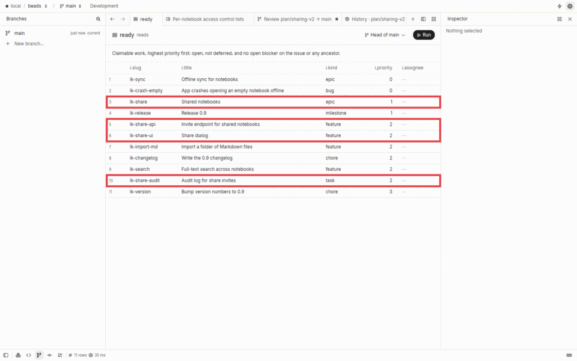
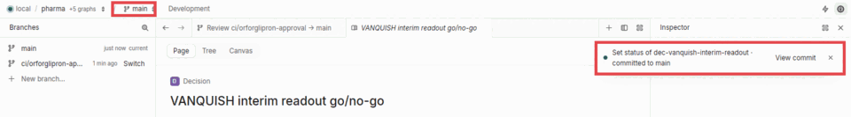
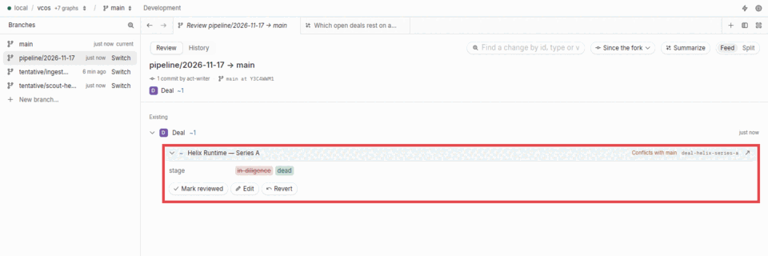
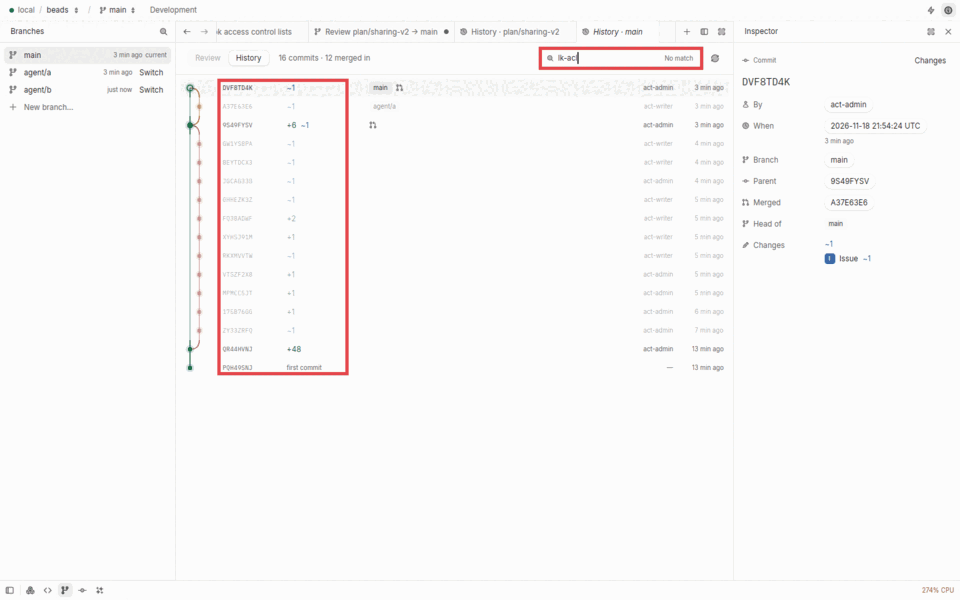
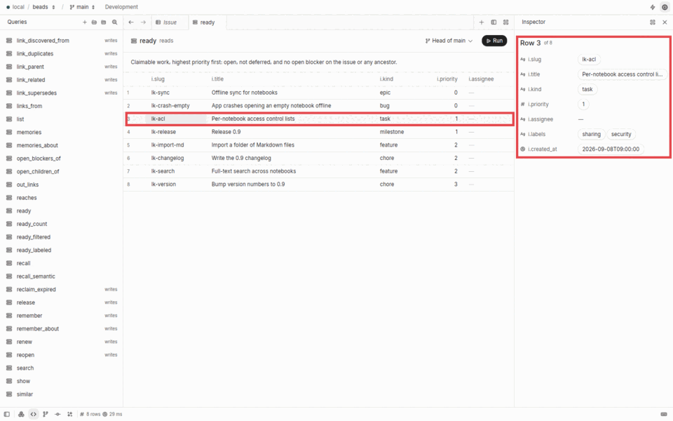
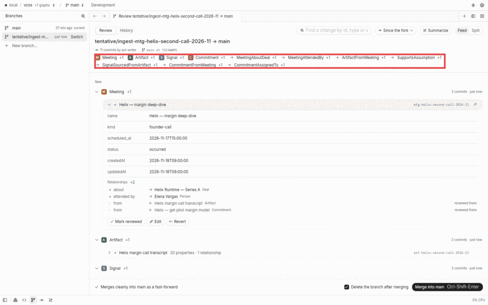
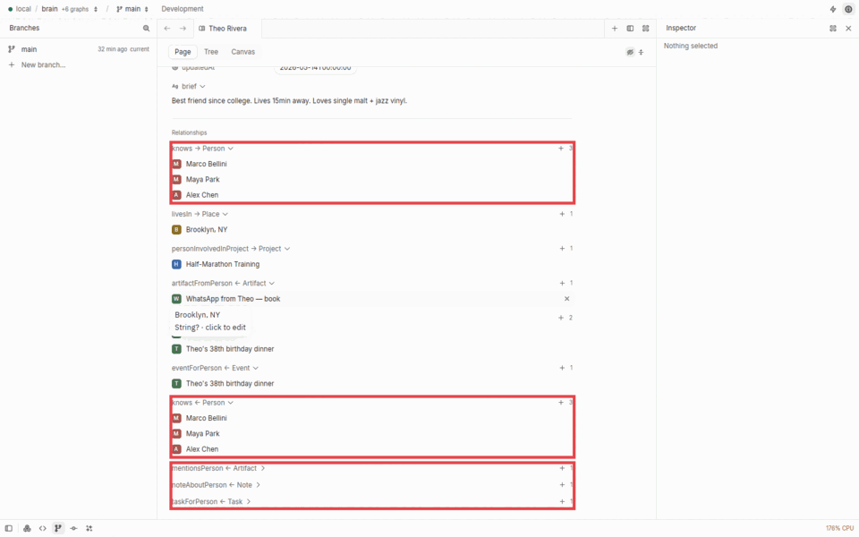

# Studio against the cookbooks: a UX study

2026-11-18 · Studio `50a495c` (origin/main) · Omnigraph `v0.15.0` CLI and server · the eight
cookbooks in [ModernRelay/omnigraph-cookbooks](https://github.com/ModernRelay/omnigraph-cookbooks)
at their `main` of the same day.

This is a design study, not a plan. It asks which high-level changes Studio needs, judged by
how real teams would use it on the eight cookbook graphs. Each proposal names the evidence
(cookbook, workflow, screenshot), a sketch, who benefits, a rough size, and what it needs from
Omnigraph. Small polish is kept to [Appendix A](#appendix-a-polish).

## Summary

Studio's browsing, review cards and write safety held up well. Six people and six agents
worked across eight graphs, and no write went anywhere it shouldn't have. Studio did fall short
in two places.

The first is the **review**. Every cookbook manages its graph through branches written by agents,
and every reviewer has the same question: *what will this do to the things we track?* Studio
answers *which rows changed*. It does not answer what the branch does to the graph's own
questions (the `ready` queue, the hygiene checks, the budget roll-up). It shows only one side
of a conflict. It does not show where a change sits in the graph.

The second is the **unit of work**. In Studio the branch is a setting of the whole window. Fixing
one edge during a review takes six steps and a window-wide branch switch. Running a stored
query on the agent's branch means moving everything else to that branch too. Studio also can't
tell an edit on `main` from an edit on a draft branch, so a writer's single click commits
straight to `main`.

Ranked proposals (detail in [Proposals](#ranked-proposals)):

| # | Proposal | Cookbooks | Size |
|---|---|---|---|
| 1 | The review shows what a branch does to the graph's own questions: query diffs and checks before merge | 7 of 8 | L |
| 2 | The branch belongs to the tab, not the window; edits on a protected branch become a proposal | 8 of 8 | L |
| 3 | Conflicts with three sides and a resolution | 7 of 8 | M |
| 4 | Why something changed: commit intent and a node's history | 7 of 8 | M |
| 5 | The graph's own verbs: result rows are nodes, stored mutations are node actions | 7 of 8 | M–L |
| 6 | A branch's change as a graph: anchors and the other end of every edge | 6 of 8 | M |
| 7 | Agent work as lanes: compare branches, see who opened them, see when they are merged | 5 of 8 | M |
| 8 | Pages and trees shaped by the type: body first, relationships that matter first, values in the tree | 6 of 8 | M |
| 9 | Opening a graph as someone: the identity is chosen, shown and kept apart from app-level authors | 4 of 8 | S–M |

## Method

**Graphs.** All eight cookbooks were combined into one local cluster with eight graphs. Each
graph kept its own schema, stored queries and Cedar policy; the one cluster-scoped policy is the
cookbooks' shared `server.policy.yaml`, with `act-alice` added as company-brain's is. The
cluster was applied directly to a local root, served by `omnigraph-server` `v0.15.0` behind the
cookbooks' `scripts/local-tls-gateway.py`, and every seed was loaded with
`load --mode append`. The CLI got one target per role (`local`, `local-writer`,
`local-reader`, `local-agent`, `local-alice`, `local-notes-bot`, `local-slack-bot`). Studio
read those targets through the CLI, as it does on a person's machine.

**Studio.** A debug build of `origin/main` (`50a495c`) ran under Xvfb (1600×1000, 24-bit),
rendering through Mesa's lavapipe (llvmpipe, Vulkan 1.4) on a 2-core Linux box. It was driven
three ways:

- through its own MCP UI tools server (spec 032), with a small Streamable-HTTP client playing
  the outside agent;
- with `xdotool` for clicks and keys;
- with screenshots of the X display.

To give each persona its own credential, Studio was restarted with the `local` target's token
set to theirs: `act-alice` for company-brain, `act-writer` for the rest, and `act-admin` on
the first beads pass. Agents wrote through the CLI with their own targets, as the cookbooks
describe.

**Limits.**

- The seeds are small (48 to 667 records), so this study says nothing about scale.
- The agent panel stopped at "Sign in to Claude": the box had no credential the ACP adapter
  could use ([f15](2026-11-18-cookbook-study/f15-vcos-agent-panel-sign-in.png)). Its turn
  flow was not exercised. The outside-agent path (MCP) was exercised throughout.
- No GPUI tests or offscreen snapshots were written. The study runs the real binary.
- On X with no window manager, Studio's 30-second head and branch poll ran only after the
  window got X focus (`xdotool windowfocus`). A person's desktop does that for them.
- Agents are simulated with exact CLI calls taken from each cookbook's README. No model wrote
  these rows.

Screenshots are in [`2026-11-18-cookbook-study/`](2026-11-18-cookbook-study/), scaled to 960 px,
with red boxes on the evidence.

## Personas and jobs

Each persona comes from the cookbook's README, seed notes, schema, stored queries and policy,
checked against the live graph with reads.

### Beads (`beads`): the agent work-queue operator

- **Who.** A tech lead running several coding agents on one repository. The agents
  (`agent-planner`, `agent-builder`, `agent-reviewer`) file, claim and close issues dozens of
  times an hour through `ob`, all as `act-writer`. Only `act-admin` may merge. `act-agent`
  has no access to this graph.
- **Jobs.**
  - Every morning: see claimable work (`ready`, 8 rows), what is blocked and why (`blocked`,
    `blocked_by_ancestor`, `ancestor_blockers`), and stale claims (`expired_leases`).
  - Weekly: what the agents filed and closed, and duplicates (`search`, the `Duplicates`
    edge).
  - Planning: epics on a `plan/…` branch that an admin merges.
- **Anxieties.**
  - Two agents claim one issue.
  - A lease lapses unseen.
  - An agent closes work wrongly.
  - A human edit loses the `updated_at` compare-and-swap the agents rely on.
  - Merging a plan changes what is ready without anyone seeing it.

### Company brain (`company`): the head of payments reviewing her agents

- **Who.** Alice Park (`act-alice`), Head of Payments at a six-person company. She reviews
  what her meeting-notes agent (`act-notes-bot`) and the CTO's Slack agent (`act-slack-bot`)
  propose on `agent/…` branches. She merges, then verifies claims and accepts decisions on
  `main`. Agents may write only unprotected branches and can't merge.
- **Jobs.**
  - Daily: the review queue (`unverified_claims`, `proposed_decisions`, `contested_claims`).
  - "What did Tuesday's sync produce" (`claims_from_source`).
  - "Why did we decide X" (`decision_evidence`, `why_superseded`).
  - Before every merge: the nine hygiene checks in `hygiene.gq` ("Zero rows on a healthy
    graph").
- **Anxieties.**
  - A quote the agent paraphrased or misattributed.
  - A decision accepted on unverified claims.
  - An agent rubber-stamping its own work on its branch.
  - Two agents proposing rival successors to one decision.

### Hardware program (`program`): the systems engineer before a design review

- **Who.** Amara Okafor, systems engineer on a 150 kg Earth-observation smallsat, midway to
  its critical design review. She writes as `act-writer`; subsystem owners do the same. A
  requirements-checker agent (`act-agent`) raises findings and drafts `ai_generated`
  requirements on branches.
- **Jobs.**
  - Whether each budget closes (`budget_rollup`, `budget_contributors`), limit and
    verification status.
  - Design-review gates (`gate_*` with `ms-cdr`).
  - The impact of a requirement change (`impacted_*`), traceability (`trace_up`).
  - Trade studies on branches.
  - Merges written as unpublished commits, checked, then published.
- **Anxieties.**
  - A budget that closes only on an optimistic estimate.
  - A passing test that no longer proves anything.
  - An agent stepping into engineering decisions.
  - A trade branch merged without its rationale.

### Development graph (`dev`): the engineering lead

- **Who.** Nadia, engineering lead at a five-person docs startup, with ICs, an SRE, a PM, a
  triage agent (`agent:orion`) and CI (`svc-ci`). Everyone writes as `act-writer`; who did
  what is recorded in `createdBy`/`updatedBy` properties. Writers may merge.
- **Jobs.**
  - Ready work (`ready`) and the six `blocked_*` views that explain exclusions.
  - Incident walks (`incident_root_cause`).
  - Governance (`unheld_invariants`, `gaps_undermining_invariants`).
  - Release contents.
- **Anxieties.**
  - Edits to append-only decisions.
  - Duplicate unkeyed edges.
  - A PR that widens a gap.
  - Provenance that lives only in a property.

### Industry intel (`spike`): the market-intelligence analyst

- **Who.** A strategy analyst at an AI-infrastructure company or fund. They own five patterns
  and their insights, and run an ingest agent that files dated signals. Writers may write
  `main`; branch review is the team's habit. The stored mutations set required fields only.
- **Jobs.**
  - Weekly intake (`recent_signals`) to zero orphans (`orphan_signals`).
  - Momentum and staleness (`pattern_momentum`, `stale_patterns`).
  - Provenance gaps (`unsourced_signals`).
  - Pattern dossiers.
- **Anxieties.**
  - A signal under the wrong pattern.
  - Duplicate elements and duplicate unkeyed edges that inflate momentum.
  - Weak evidence.
  - Invented dates or URLs.

### Pharma intel (`pharma`): competitive intelligence before a committee

- **Who.** The CI and strategy lead at the sponsor (Viking Therapeutics) and the functional
  owners of open questions. An analyst agent maps public signals to compounds, assumptions
  and questions.
- **Jobs.**
  - Pre-committee brief: `decisions_upcoming`, then `decision_assumptions` and the signals for
    and against each assumption.
  - "What happened in my space" (`program_landscape_signals`).
  - The impact of a new signal.
- **Anxieties.**
  - A contradiction nobody sees before a decision.
  - Stale state: decisions still `upcoming` after their date, because dates are strings.
  - A signal linked to the wrong compound.

### Second brain (`brain`): one person and their capture agents

- **Who.** Alex Chen, a product designer, with capture agents for WhatsApp, email, calendar
  and notes apps. Everything writes as `act-writer`. The data is private and emotional
  (journals, therapy).
- **Jobs.**
  - Before seeing a friend: their notes, what I owe them, our last events.
  - Daily next actions.
  - A weekly review of tasks, habits and projects.
  - Provenance of a derived note.
- **Anxieties.**
  - An agent overwriting a hand-written note.
  - Duplicate people.
  - A wrong "I owe / they owe".

### VC OS (`vcos`): the partner before an IC

- **Who.** Partners at a Berlin fund, plus agents:
  - Granola ingest on `tentative/ingest-…`
  - scout triage
  - IC debaters
  - enrichment

  The README's rule is that agents propose and partners merge. Policy doesn't enforce it.
- **Jobs.**
  - IC prep (`pre_ic_brief_*` ×5 for one deal).
  - The Monday pipeline (`deals_open`, `deals_by_stage`).
  - A founder intro path, board prep.
  - Belief drift (`contradicted_active_theses`).
- **Anxieties.**
  - A deal's stage changed wrongly.
  - A thesis edited without a record.
  - Duplicate people from fuzzy names.
  - A tentative lesson treated as active.

## Workflows walked

Thirty-seven workflows, at least four per cookbook. "f…" names a screenshot in this study.

| Cookbook | Workflow | What was done in Studio (and by agents through the CLI) | Shot |
|---|---|---|---|
| beads | B1 Morning triage | Issue table; filter `status = open`; Queries panel, `ready` (run by hand); select a result row; open `lk-acl`'s page and its relationships | f01 |
| beads | B2 Stale claim | `expired_leases`; History search for `lk-acl` ("No match") | f05 |
| beads | B3 Plan on a branch by hand | Branches → New branch `plan/sharing-v2`; edit `lk-acl.priority`; New Issue `lk-share-audit`; add `BlockedBy` and `ChildOf` from the inspector | f17 |
| beads | B4 Agent on the branch, review, merge | `claim`, `link_blocks`, `comment`, `close` as `act-writer`; open the review; Split and History; Revert; merge; rerun `ready` | f02, f03 |
| beads | B5 Two agents claim one issue | Branches `agent/a` and `agent/b`; merge `a`; review `b` shows the conflict; resolved by writing main's row onto `b` (CLI, dry run `merged`) | — |
| company | C1 Review queue | Claim table; a claim's page from the inspector | — |
| company | C2 Notes agent proposes | `record_source`, `record_claim`, `mark_contradiction`, `propose_successor` as `act-notes-bot`; review; `decisions_at_risk` on the branch; merge | f04 |
| company | C3 Verify and accept on main | `verify_claim` from the Queries panel with its confirm bar; `reject_claim` | f14 |
| company | C4 Rival successor | The Slack agent's branch from the pre-merge commit; review shows the `@card` conflict; review range options | f07 |
| program | P1 Budget drill-down | `budget_rollup`; tree from `dc-pl-mass` through `AllocatedTo`, `PartOf`, `Characterizes` (MCP `tree_expand`) | f09 |
| program | P2 Trade study | Two branches `set_parameter`; review light; merge; review carbon (conflict) | f08 |
| program | P3 Agent fixes a vague requirement | `revise_requirement`, `bound_parameter`, `raise_finding` as `act-agent`; review | — |
| program | P4 Change with a gate on the merge result | Looked for a way to merge as an unpublished commit, check gates there, publish: none in Studio | — |
| program | P5 Schema map | Map tab ("From Interface") | — |
| dev | D1 Ready vs blocked | Issue table; the six `blocked_*` views in the list | — |
| dev | D2 Incident walk | Canvas from `inc-presence-leak`; expand; fit | f16 |
| dev | D3 Triage agent | `create_issue`, `link_…`, `set_issue_priority`, `add_comment_on_issue`, `assign_issue_owner` on `review/orion-triage`; review; merge | — |
| dev | D4 Duplicate owner edge | The same `assign_issue_owner` on main; merge; commit view; a query confirms two identical edges | — |
| spike | S1 Intake | Signal table | — |
| spike | S2 Intake agent | `add_signal`, `add_artifact`, three links on `intake/2026-11-18`; review | f10 |
| spike | S3 Finish the row in review | Edit (domain, description) from the card; remove the `RelevantCompany` edge (branch switch, page, ×); merge | — |
| spike | S4 Two intake runs, one slug | `intake/b` review: divergent insert | — |
| pharma | R1 Pre-committee brief | Tree from `dec-oral-phase3-start` through assumptions to the signals for and against | — |
| pharma | R2 Agent mislinks a compound | `add_signal` and four links on `ci/orforglipron-approval`; review | — |
| pharma | R3 Decision housekeeping | Status enum on the decision's page, as `act-writer` on `main` | f11 |
| pharma | R4 Who changed it | History search for `dec-vanquish` ("No match") | — |
| brain | N1 Before dinner with Theo | Ctrl-K "Theo"; Theo's page | f13 |
| brain | N2 Weekly review | Branch `review/2026-w47`; new Note; long markdown content on its page | — |
| brain | N3 Capture agent | `add_artifact`, `add_task` and links plus an overwrite of a hand-written note on `capture/whatsapp-…`; review | — |
| brain | N4 Calendar race | `HappenedAt` (`@card 0..1`) on two branches; dry run `cardinality_violation` | — |
| vcos | V1 IC prep | Ctrl-K "Helix"; the deal; the wiki artifact's page | — |
| vcos | V2 Granola ingest | 11 writes on `tentative/ingest-…`; review | f12 |
| vcos | V3 Ask the agent | Agent panel, Claude Agent, one question with a write: stopped at sign-in | f15 |
| vcos | V4 Two stages for one deal | Scout branch merged; `pipeline/…` review conflicts | f06 |
| all | O1 Outside agent drives the window | The MCP client listed windows and tabs, opened types, pages, trees, canvases, reviews and history, expanded trees and canvases | — |
| all | O2 Restart as another identity | `act-alice`, `act-writer`: what the Open dialog and a restored window show | — |
| all | O3 Read a commit | History → commit → its changes and inspector | — |

The full friction log, with the step and what the person needed, is in
[Appendix B](#appendix-b-friction-log).

## What works, and should stay

- **Write safety and scope.** Every editor names the branch it writes to ("↵ save · write ·
  plan/sharing-v2"). The new-node and edit dialogs carry `local › beads › plan/sharing-v2`.
  A stored mutation's confirm bar reads "local › company › main · verify_claim changes data
  on main". Nothing wrote where it didn't say ([f14](2026-11-18-cookbook-study/f14-company-verify-claim-free-text.png)).
- **Review cards.**
  - Per-entity before and after, with word-level text diffs: the agent's rewrite of
    `dc-adcs-jitter`, the overwrite of Alex's whisky note.
  - The type summary line, and "N commits by act-notes-bot".
  - The merge check before Merge ("Merges cleanly into main as a fast-forward" / "1 conflict
    stops a merge"), and a conflicts list that names the kind.
- **Navigation.**
  - Node search across types (Ctrl-K).
  - The inline relationship picker, which shows names and ids.
  - The relationship tree, which made the pharma evidence chain and the program roll-up
    walkable.
  - Commit views, and history lanes for merged-in branches.
- **Agents outside Studio.** The UI tools did what an agent needed to put things in front of a
  person (open type, page, tree, canvas, review, history; expand, fit). They answered with
  identifiers and names only, and the "Opened by ux-study" chip appeared each time.

## Ranked proposals

Ranked by how many personas and workflows hit the problem, and how much it costs them when
they do: a wrong merge costs more than an extra click. Engine IDs refer to
[spec 012](../../specs/012-omnigraph-engine-changes/plan.md) and
[deferred-engine-changes.md](../deferred-engine-changes.md). IDs E60 to E64 are *proposed
here* (E55 to E59 went to spec 035) and filed as Omnigraph issues #1470 to #1474. They are not yet in spec 012; a proposal that is adopted adds them there, as `AGENTS.md`
requires.

### 1. The review shows what a branch does to the graph's own questions

**Problem.** Every cookbook encodes "is the graph healthy" and "what matters now" as stored
reads. The review shows changed rows, never what those rows do to the reads:

- **beads B4.** Closing `lk-acl` makes `lk-share`, `lk-share-api`, `lk-share-ui` and the new
  `lk-share-audit` ready. The review shows a status change. The open `ready` tab says
  "Newer data · Refresh" and, refreshed, shows 11 rows with nothing marking the four new
  ones ([f03](2026-11-18-cookbook-study/f03-beads-ready-after-merge-no-marks.png)).
- **company C2.**
  - The nine hygiene checks sit as nine rows in a flat list of 69 queries; nothing runs them
    against the branch before Merge.
  - `decisions_at_risk`'s own description says "Run it on an agent's branch". The query tab
    offers only main's head and commits, never another branch
    ([f04](2026-11-18-cookbook-study/f04-company-query-picker-main-only.png)). Alice switched
    the whole window to the agent's branch, ran it (1 row), and switched back to compare from
    memory.
- **program P2.** The trade-study review shows `p-mass-optics` 24.5 → 21.4. The engineer's
  question is whether `dc-pl-mass` now closes (30.8 → 27.7 against 28 kg)
  ([f08](2026-11-18-cookbook-study/f08-program-trade-review-value-only.png)). Comparing main
  and two trade branches meant three branch switches. P4: the cookbook checks design-review
  gates on an unpublished merge commit before publishing; Studio has no way to do that.
- **dev, spike, pharma, vcos.**
  - `unheld_invariants`, `orphan_signals`/`unsourced_signals`, `decisions_upcoming` and
    `contradicted_active_theses` are each "the number that should move".
  - dev D4: the review said "Merges cleanly" for a branch that added an unkeyed edge main
    already had. After the merge Mei Lin owns `iss-safari-login` twice.
  - spike S4: the same `FormsPattern` edge on two intake branches would duplicate and inflate
    `pattern_momentum`.



**Proposal.** The review gets a third view beside Review and History: **Effect**. It lists the
graph's *checks* and *watched reads*, each run at the reviewed head and at the target's head,
with the rows that appear and disappear. Checks are reads that should return nothing; a check
with rows holds the merge button behind one more key, as a conflict does today. Studio adds
built-in checks it can run itself:

- an unkeyed edge the target already has between the same ends;
- a new node with required-by-convention fields left empty (see 5);
- a new edge whose other end is not readable.

```
┌ Review  History  Effect ─────────────────────────────────────── Since the fork ▾ ┐
│ plan/sharing-v2 → main · 11 commits by act-admin, act-writer                     │
│                                                                                  │
│ Checks                                          main        branch               │
│  ✓ hygiene · unsupported_decisions               0           0                    │
│  ✗ built-in · edge already on main               —           1  IssueOwnedBy …  ▸ │
│                                                                                  │
│ Watched                                                                          │
│  ready                                           8 rows      11 rows   +4 −1   ▸ │
│    + lk-share        Shared notebooks          epic   P1                         │
│    + lk-share-api    Invite endpoint …         feat   P2                         │
│    − lk-acl          Per-notebook access …     task   P1                         │
│  budget_rollup  (params: none)                   5 rows      5 rows    ~1      ▸ │
│    ~ dc-pl-mass  allocated 30.8 → 27.7   violated true → false                    │
│                                                                                  │
│ [Pick reads to watch…]          Merge result: [Check as unpublished commit]      │
└──────────────────────────────────────────────────────────────────────────────────┘
```

- *Which reads.* The person marks a zero-parameter stored read (or a saved view, spec 024) as
  *watched* or *a check*. Studio keeps the mark per graph in settings. With E64, a check can
  come from the graph itself.
- *Rows that changed.* Rows are matched by the node a row names (see 5) or, failing that,
  by the whole row. The same diff marks rows in any query tab that refreshes ("+4 −1 since
  the last run").
- *Merge result.* "Check as unpublished commit" merges `as_commit` (R2), runs the checks at
  that commit, then offers Publish or Drop: the hardware program's own gate flow.

**Who benefits.** Every reviewer of an agent's branch, in seven cookbooks: B4, C2, P2, P4, D1/D4, S2/S4, R1, V1.

**Size.** L. Two reads per watched query (bounded and cancellable, constitution IX), a row-diff
component in `change_cards`, settings for marks, and the R2 merge path in `review`.

**Engine.**

- Works today: a stored read takes `branch` or `snapshot` in its body (checked: `omnigraph
  query decisions_at_risk --branch …` answers `target.branch`), and R2 is served.
- Proposed **E64**: the catalog entry (`QueryCatalogEntry` today: name, description,
  instruction, mutation, params, tool_name) carries the query's source file and tags (for
  example `@tag("check")`), so a graph can declare its checks once for every client.
- E35 matters here: a diff across a merge reads both tables.

### 2. The branch belongs to the tab, not the window; a protected branch takes proposals

**Problem.** A window has one branch. A review, a query tab and a page each need their own
branch. Studio offers two ways round this: pinned read-only views, or switching the whole
window.

- **spike S3.** Removing one off-topic edge during review means opening the Branches panel,
  switching the window to the branch, opening the node's page again, pressing × twice,
  returning to the review and pressing Refresh. The review's inspector, and the page opened
  from it, are pinned to the reviewed commit and read-only ("click to copy").
- **company C2.** To run a check on the agent's branch, Alice moved the window there, which
  made every tab, and every edit, target the agent's branch until she moved back
  ([f04](2026-11-18-cookbook-study/f04-company-query-picker-main-only.png)).
- **company C1.** A claim opened from the review shows branch data while the top bar says
  `main`.
- **pharma R3.** As `act-writer`, one click on an enum committed straight to `main`
  ([f11](2026-11-18-cookbook-study/f11-pharma-one-click-commit-to-main.png)). Every cookbook
  README says "review on a branch". Every policy declares `protected_branches: [main]`, though
  only company-brain and hardware-program deny agents `main`. Studio can't tell, because
  `AccessOutput` says what the actor may do, not which branches are protected.
- **beads B3, brain N2.** Starting a planning or weekly-review branch, then working on it,
  took a dialog and a window switch each time.



**Proposal.**

- **A tab carries its branch.** A review, a query tab or a page opened from a branch is *on
  that branch*, shown in its own header, and edits from it write there. The window's branch
  becomes the default for new tabs. A review's inspector and the pages opened from it are
  editable on the reviewed branch, with Remove and + on relationships. The query tab's picker
  lists branches as well as commits.
- **Proposals.** When the window is on a branch the graph treats as protected (E63), or the
  person turns on "Propose changes", the first edit starts a proposal branch:
  `proposal/<actor>/<date>-<n>`, named from the first edit and renameable. The edit lands
  there, and the status bar shows "3 changes proposed · Review". One step opens the review.

```
 local / pharma / main ⌄                              Proposing on  proposal/act-writer/1118-1 ⌄  3 changes · Review ⌘⇧R
 ┌ VANQUISH interim readout go/no-go ─────────────────────── on proposal/act-writer/1118-1 ┐
 │ status  [decided ⌄]  ← main: upcoming                                                │
```

**Who benefits.** All eight. The biggest savings are in spike S3 (6 steps → 1), company C2 and
pharma R3, where a wrong write to main is avoided.

**Size.** L. It touches constitution XIII's rule that "the top says which server, graph and
branch": the top would keep the window's default and each tab would say its own. The plan
should amend XIII rather than work around it. `GraphSession` already writes to an explicit
branch (spec 011), so the store's side is small; most of the work is in the views and the
inspector.

**Engine.** Proposed **E63**: `AccessOutput` (or the branch list) says which branches the
policy treats as protected, so Studio can offer proposals without guessing. Without it, Studio
treats `main` as protected unless the person turns proposals off.

### 3. Conflicts with three sides and a resolution

**Problem.** A conflicting card shows the branch's values against its fork. It never shows the
target's current value, who set it, or the base.

- **vcos V4.** "in-diligence → dead · Conflicts with main". Main is now `ic-ready`, set by
  the scout agent's merged branch. Neither the value nor its author is shown
  ([f06](2026-11-18-cookbook-study/f06-vcos-conflict-shows-one-side.png)).
- **program P2.** The carbon card shows 24.5 → 22.6 while main already holds 21.4.
- **beads B5.** The conflict list says "divergent update for id lk-crash-empty" and nothing
  more.
- **company C4.** "More relationships than the schema allows · SupersededBy – ·
  checkout-launch-nov-13 has 2 edges (max 1)". The two rival successors (Nov 20 on main, Nov 27
  here) and the claims behind them are not shown
  ([f07](2026-11-18-cookbook-study/f07-company-cardinality-conflict.png)).
- **spike S4, brain N4.** Divergent insert, and the `HappenedAt` race: the same gap.
- In every case the only offered fix is "Fix each on the branch, then merge".



**Proposal.** A conflict card has three columns and a decision.

```
 Helix Runtime — Series A   Deal · deal-helix-series-a           Changed on both branches
            base (fork)        main (now)                    this branch
 stage      in-diligence       ic-ready   by act-writer,     dead   by act-writer
                               tentative/scout-helix · 2h
 [Keep main's]  [Keep this branch's]  [Edit…]      ↵ writes to pipeline/2026-11-17
```

- **Keep main's** writes main's values onto the branch, bound to the branch head. Verified in
  beads B5: once `agent/b`'s row matched main's, the dry run answered `merged`.
- **Keep this branch's** needs the engine (E61).
- **Edit…** opens the row on the branch with both values in reach.
- For an edge `@card` conflict: the competing edges and their other ends, each with Remove
  on the branch.
- For a divergent insert: both rows side by side.

**Who benefits.** beads, company, program, spike, brain, vcos and pharma (its README's
`divergent_update` on decision status): 7 of 8.

**Size.** M. Today Studio can read the three images of a keyed node itself, at the merge base,
the target head and the branch head (three snapshot reads), which covers node conflicts until
E53 lands. Edge conflicts need the target's edges of the named source, also one read.

**Engine.** **E53**, already deferred: the images from the server, exact and in one answer.
Proposed **E61**: a merge that takes a side for named entities (`prefer: source` for the listed
ids), so "Keep this branch's" is one merge rather than a write to `main`. The constitution's "a
write carries the commit it was read at" still holds: the resolution is bound to the dry run's
heads.

### 4. Why something changed: commit intent and a node's history

**Problem.** History lists commits as an id, a count and an actor
([f05](2026-11-18-cookbook-study/f05-beads-history-no-operation-no-node-search.png)).

- **beads B4.** The agent's `claim`, `link_blocks`, `comment` and `close` are four "~1 /
  +1" rows. The CLI's receipt carries `"query_name": "close"`, but `CommitOutput` keeps none of
  it (its fields: actor_id, created_at, graph_branch, graph_commit_id,
  graph_manifest_version, kind, merged_parent_commit_id, parent_commit_id, published,
  root_commit_id).
- **beads B2, pharma R4, vcos.** History search for a node ("lk-acl", "dec-vanquish") answers
  "No match"; it searches ids and actors. "When did the agent last touch `lk-queue`?" and
  "who changed this deal's stage?" mean opening commits one by one. Neither a page nor the
  inspector has a history.
- **beads B4.** One review card merges the human's priority edit and the agent's close,
  "4 commits", with no author per field
  ([f02](2026-11-18-cookbook-study/f02-beads-review-card-mixed-authors.png)).
- **dev D3, brain N3.** Every author is `act-writer`; the real author lives in an
  `updatedBy: agent:orion` property, or nowhere.



**Proposal.**

- A history row reads as a sentence: "act-writer · close lk-acl · 2 min ago", "act-alice ·
  verify_claim provider-certifies-nov-13". A writer's own message shows when there is one.
  Studio's own writes already have the words ("Set priority of lk-acl").
- A page and the inspector get a **History** view of that node: each change, with its
  operation, author and before/after, from the review's change cards.
- Review cards show the author per changed field ("priority 1 → 0 · act-admin", "status open
  → closed · act-writer, close").

**Who benefits.** Seven of eight. The "who and why" question came up in beads, company,
program, dev, pharma, brain and vcos, and the per-field author in beads and dev.

**Size.** M. The history view of a node can start without the engine by walking first-parent
commits' changes filtered by type (bounded, with an honest "read the last 200 commits"
exit).

**Engine.**

- Proposed **E60**: a commit's operation (the stored query's name, or `mutate`, `load`,
  `merge`, `blob put`) and an optional writer-supplied message, in `CommitOutput`.
- Proposed **E62**: commits that changed one entity, paged (an `id` filter on
  `GET /commits/{id}/changes`, or on the change feed).
- **E20** (delegated credentials recorded beside the actor) answers "which agent".
- **E44** (counts in the listing) makes the rows cheap.

### 5. The graph's own verbs: result rows are nodes, stored mutations are node actions

**Problem.** The cookbooks speak through stored queries. Studio shows them as text grids and
forms that aren't connected to the nodes they are about.

- **beads B1.** A `ready` row is "Row 3 of 8" with `i.slug`, `i.title`: not the issue. No
  page, no edges, no right-click, no claim
  ([f01](2026-11-18-cookbook-study/f01-beads-result-row-is-not-a-node.png)). The same in
  program P1 (`budget_rollup`, whose `violated` column is cut off at the edge) and vcos V1.
- **company C3.** `verify_claim` takes `$slug` as free text, with no Claim picker
  ([f14](2026-11-18-cookbook-study/f14-company-verify-claim-free-text.png)). The claim's page
  has no Verify or Reject; the verbs are rows in the Queries panel.
- **beads B3, program, dev.** A hand edit doesn't stamp `updated_at`/`updatedBy`. Beads'
  `edit` and the program's `revise_requirement` are compare-and-swap on `updated_at`, so an
  agent working from a stale read can overwrite a human edit. Writing through the graph's
  verbs would keep the graph's own rules.
- **Queries panel.** 60 to 70 stored queries in one alphabetical list, reads and writes mixed
  ([f04](2026-11-18-cookbook-study/f04-company-query-picker-main-only.png) left). Descriptions
  are only on hover; `instruction` ("For people, on main after merging…") only inside the tab.
  A zero-parameter read opened from the list waits for Run.
- **spike S2, pharma.** Stored mutations set required fields only, so every agent row needs
  finishing ([f10](2026-11-18-cookbook-study/f10-spike-new-node-hides-unset-fields.png)).



**Proposal.**

- **A result row is a node** when the query projects a node's key: the row selects the node,
  opens its page, shows on a canvas (`ShowResultsOnCanvas` already does it for local queries),
  and carries the node's actions. Boolean flags such as `violated` get a state chip.
- **Node actions from mutations.** Where a stored mutation's key parameter names a node of
  this type, the page and the row's menu offer it: "Verify claim", "Reject claim", "Claim",
  "Close". It opens as a form with that parameter filled, other node parameters as pickers,
  and the confirm bar it has today.
- **A catalog shaped by use.** Queries grouped by source file, with pinned favourites at the
  top; descriptions under the name; zero-parameter reads run on open; "watch" and "check"
  marks (proposal 1).
- **Write conventions per graph.** A setting maps "stamp on every write" properties
  (`updated_at` ← now, `updatedBy` ← actor) so hand edits keep the graph's rules.

```
 Per-notebook access control lists                          Issue · lk-acl
 [Claim…] [Close…] [Defer…] [Link blocks…]      ← from mutations.gq, on plan/sharing-v2
```

**Who benefits.** beads, company, program, dev, spike, pharma and vcos.

**Size.** M–L. Rows as nodes for *local* `.gq` queries need no engine: `gq_language` knows each
column's variable. For stored queries they wait on E43.

**Engine.**

- **E43** (a stored query's result columns with their variable, type and property).
- Proposed **E64**, extended: a mutation's descriptor names the type it writes and the
  parameter that identifies its target. Without it, Studio can offer an action only where the
  person maps it once.
- **E40** would let a roll-up's margin be a server column.

### 6. A branch's change as a graph: anchors and the other end of every edge

**Problem.** Reviewers judged a change by what it hangs on, and the review lists changes by
type.

- **vcos V2.** Granola's 4 nodes and 7 edges are listed as Meeting, Artifact, Signal,
  Commitment. The partner thinks of "one call, hung on `deal-helix-series-a`, attended by
  Elena, supporting `asmp-helix-onprem-margin`"
  ([f12](2026-11-18-cookbook-study/f12-vcos-ingest-review-by-type.png)).
- **company C2.** The new claim contradicts `provider-certifies-nov-6`. To read Chen's quote
  beside the agent's, Alice left the review for a page tab.
- **pharma R2.** "FDA approves orforglipron → about VK2735 (subcutaneous)" was catchable
  only because the target's name gave it away. Its owner and phase were one hop further.
- **spike S2.** To judge "forms → Sovereign AI" the analyst needs that pattern's other
  signals.



**Proposal.** A **Graph** view of the review: the changed nodes, the existing nodes they attach
to (one hop), and the changed edges marked by kind. A changed edge's card shows its other end's
key fields inline: a quote, a phase, a value.

```
 Review  History  Effect  Graph
     ┌──────────────┐  about   ┌────────────────────────┐ supports  ┌──────────────────────┐
     │+ Meeting      │────────▶│  Deal  Helix Series A   │          │ Assumption on-prem   │
     │ margin deep-  │         │  stage in-diligence      │◀─ ─ ─ ─ ─│ margin   conf 0.6    │
     │ dive  11-17   │──┐      └────────────────────────┘    ┌─────│                      │
     └──────────────┘  │ attended   ┌──────────────┐          │     └──────────────────────┘
          │ from        └──────────▶│ Elena Vargas │   ┌──────┴───────┐
     ┌────▼──────────┐              └──────────────┘   │+ Signal 62%   │
     │+ Transcript    │◀──────────── sourced from ─────│ gross margin  │
     └───────────────┘                                 └───────────────┘
   + new   ~ changed   ─ existing, read at main
```

**Who benefits.** vcos, company, pharma, spike, brain and dev (the incident chain).

**Size.** M. The canvas already draws a set of nodes and their links (`with_results`). It needs
the review's set, one-hop anchors and the change marks. Spec 006's caps apply.

**Engine.** None. **E16** (neighbourhood counts) would make the anchors cheaper.

### 7. Agent work as lanes: compare branches, see who opened them, see when they are merged

**Problem.**

- **company C4, program P2, spike S4.** Two agents' branches answer the same question
  differently. The review compares a branch only with its target ("Since the fork" or one
  commit) ([f07](2026-11-18-cookbook-study/f07-company-cardinality-conflict.png) context).
- **Branch list.** Merged-but-kept branches (`tentative/scout-helix`, `agent/a`) look like
  live ones. Agent branches (`agent/`, `tentative/`, `capture/`, `intake/`, `ci/`) mix with
  human ones.
- **beads B5.** New branches appeared only at the next poll, and the outside agent's
  `graph_open_branch` answered "not a branch" until then.

**Proposal.**

- **Compare** any two branches or commits, with the review's cards and Effect view (proposal
  1).
- The Branches panel groups by prefix and by the actor who opened the branch. It marks a
  branch "merged" when its head is in the target, offering Delete (↵, since nothing is lost),
  and shows "3 commits ahead".
- A Refresh on the panel; a branch-list read when an outside agent names an unknown branch.

**Who benefits.** company, program, spike, beads and vcos.

**Size.** M.

**Engine.**

- Works today: **E6** `GET /diff` between any two heads; **E9** detailed branches (served by
  0.15: head, start, created and updated).
- E9's details lack the creating actor; proposed as part of **E60**.

### 8. Pages and trees shaped by the type

**Problem.** A page lists every property in schema order, then every relationship in schema
order.

- **vcos V1.** The wiki artifact's 18 sync fields come before its body.
- **brain N1.** On Theo's page, `knows →` and `knows ←` list the same three people twice. His
  preference note and the task Alex owes him are collapsed at the bottom
  ([f13](2026-11-18-cookbook-study/f13-brain-person-page-order.png)).
- **beads B1.** "blockedBy ← Issue" means "Blocks".
- **program P1.** The tree shows "Imager optics mass", not 24.5 kg (estimated), which is the
  whole reason for the drill-down
  ([f09](2026-11-18-cookbook-study/f09-program-tree-names-not-values.png)).
- **company C1.** The claim table truncates quotes at about 25 characters; `status` is
  off-screen.
- **dev D2.** The incident walk is a causal chain. On the canvas, Fit draws it as unlabeled
  dots ([f16](2026-11-18-cookbook-study/f16-dev-canvas-fit-drops-labels.png)).



**Proposal.** A per-type layout, set from the page:

- the property to lead with (body, statement, quote);
- relationships in an order the person sets, with symmetric pairs folded and incoming groups
  labelled in the reader's terms ("Blocks", "Blocked by");
- a line of each related node (a note's first sentence, a task's due date);
- the properties a tree or canvas row shows (`value unit · basis`);
- a reading layout for text-heavy types, as wrapped cards in place of truncated columns.

**Who benefits.** brain, vcos, company, program, beads and dev.

**Size.** M. Mostly settings plus page, tree and canvas rendering. Spec 014's pages and spec
023's lookup columns are the base.

**Engine.** **E27** (annotation-only display hints) would let a graph ship its layout for
everyone; until then the layout is personal.

### 9. Opening a graph as someone

**Problem.**

- Studio keys a connection by address. Seven CLI targets on `https://localhost:8443` appear as
  one server, `local`; to work as Alice, the token behind `local` had to change. The actor
  shows only in a tooltip ("as act-admin").
- **company.** Alice restored a window on a graph she can't read and got
  "policy denied action 'read' for unknown actor 'act-alice' (403)" in the Branches panel.
- **dev D3, brain N3.** The app-level author (`updatedBy: agent:orion`) is invisible next to
  the commit actor `act-writer`.

**Proposal.** The Open dialog lists the identities the CLI has for a server (one per target).
The window header shows "as act-alice". A graph the identity can't read is shown as such
before opening ("act-alice may not read beads"). A per-graph setting names the property that
holds the application author (`updatedBy`), so history and review can show it beside the
actor.

**Who benefits.** company, program (`act-agent` and `agent-checker`), dev, brain.

**Size.** S–M.

**Engine.** **E20** for agents' own credentials; **E15** already answers what an identity may
do.

## Coverage

Each cell names the workflows that hit the problem behind a proposal.

| Proposal | beads | company | program | dev | spike | pharma | brain | vcos |
|---|---|---|---|---|---|---|---|---|
| 1 Effect and checks | B4 | C2 | P2, P4 | D1, D4 | S2, S4 | R1 | — | V1 |
| 2 Branch per tab, proposals | B3 | C1, C2 | P2 | D3 | S3 | R3 | N2 | V4 |
| 3 Three-sided conflicts | B5 | C4 | P2 | — | S4 | (README) | N4 | V4 |
| 4 Intent and node history | B2, B4 | C3 | P3 | D3 | — | R4 | N3 | V4 |
| 5 Rows as nodes, verbs as actions | B1, B3 | C3 | P1 | D1 | S2 | R3 | — | V1 |
| 6 Change as a graph | — | C2 | — | D2 | S2 | R2 | N3 | V2 |
| 7 Agent lanes, compare | B5 | C4 | P2 | — | S4 | — | — | V4 |
| 8 Type-shaped pages and trees | B1 | C1 | P1 | D2 | — | — | N1, N2 | V1 |
| 9 Identity | — | C1 | P3 | D3 | — | — | N3 | — |

## Engine needs proposed here

These would go into spec 012 and `docs/deferred-engine-changes.md` if a proposal that waits on
them is adopted. Studio designs against today's API in every case above.

| ID | Change | For | Studio without it |
|---|---|---|---|
| E60 | A commit's operation (stored query name, `mutate`, `load`, `merge`, `blob put`) and an optional message; the actor that created a branch in E9's details ([#1470](https://github.com/ModernRelay/omnigraph/issues/1470)) | 4, 7 | Its own writes' words where it made them; otherwise counts and actor |
| E61 | A merge that takes a side for named entities (`prefer: source`) ([#1471](https://github.com/ModernRelay/omnigraph/issues/1471)) | 3 | "Keep main's" writes main's values onto the branch; "keep this branch's" is two steps |
| E62 | The commits that changed one entity, paged ([#1472](https://github.com/ModernRelay/omnigraph/issues/1472)) | 4 | Walks recent commits' changes filtered by type, bounded |
| E63 | Which branches the policy protects, in `AccessOutput` or the branch list ([#1473](https://github.com/ModernRelay/omnigraph/issues/1473)) | 2 | Treats `main` as protected unless the person turns proposals off |
| E64 | A stored query's source file and tags in its catalog entry; a mutation's written type and target parameter ([#1474](https://github.com/ModernRelay/omnigraph/issues/1474)) | 1, 5 | Checks, watches and actions are marked by the person, per graph |

Already deferred and cited above: E6, E9, E15, E16, E20, E27, E35, E40, E43, E44, E53, R2.

## Agents outside Studio (MCP)

Exercised in every cookbook (workflow O1). What an agent lacked:

- **No tool opens a graph.** The first window had none, so the agent could do nothing until a
  person opened one.
- **No tool switches a window's branch, or opens a review's conflicts list.** Both are needed
  to show a person "the conflict on agent/b".
- **`graph_open_branch` refuses a branch Studio hasn't polled yet.** This is the agent's usual
  case, since it just created the branch; a refusal could read the branch list once before
  answering.
- **A view tool opened a preview tab that later navigation replaced.** This matches spec 032's
  Focus rules and was right for the person.

## Appendix A: polish

Small fixes found on the way. Each is a single view's change.

- New-node dialog taller than the window, with the Insert button off-screen and no scroll; Enter
  confirms, but nothing says so ([f17](2026-11-18-cookbook-study/f17-beads-new-node-dialog-overflows.png)).
  DateTime fields have no "now". Optional relationships aren't offered (only `@card`
  minimums).
- The edit dialog shows an enum as a free text box (spike S3); the page shows the same enum as a
  menu.
- Long text in place: Enter saves and commits, and typing after it is lost. Shift-Enter is
  learned from the hint after the first save. Each save is a commit; a journal took three
  (brain N2).
- A new node's page shows an empty "Relationships" heading; empty groups (and their +) are
  behind a toggle (brain N2).
- After "Edit" in a review, the card keeps the old values and Edit is disabled until Refresh
  (spike S3).
- The "Newer data" banner appears on a review just opened and stays after Refresh (beads B4).
- Revert reverts the whole row, not the field it sits next to; its outcome offers View commit,
  not Undo (beads B4).
- Ctrl-K ranks fuzzy command matches ("Update: check for updates") above an exact Person name
  (brain N1).
- Chip badges take the first letter of the node's name ("S" for Shared notebooks, an Issue), not
  its type (beads B3).
- Canvas Fit shrinks chips past their labels ([f16](2026-11-18-cookbook-study/f16-dev-canvas-fit-drops-labels.png)).
- Wide result grids cut the last column without a scroll hint (`violated`, program P1).
- The status enum's tooltip overlaps its own menu (pharma R3).
- A restored window on a graph the identity can't read shows the server's raw 403 in the
  Branches panel.
- The commit count of a large seed commit reads "+100 …" (E44).
- "Opened by" and outside-agent toasts are clear; the outside-agent toast repeats on every start.

## Appendix B: friction log

One line per observation, as recorded: cookbook | workflow step | screenshot | what the person
needed.

- beads | B1 find `ready` | f04 (same list) | 60 stored queries, reads and writes mixed, no file grouping; descriptions on hover; `ready` below the fold. Needed: the daily queries at the top.
- beads | B1 open `ready` | — | opens without running; a zero-parameter read still needs Run.
- beads | B1 act on a ready row | f01 | "Row 3 of 8", columns only; no page, edges or actions. The query binds `$i: Issue` and returns its key.
- beads | all | — | the Open dialog shows one server for seven CLI targets on one address; no choice of identity.
- beads | B3 hand edit | — | `updated_at` not stamped; agents' compare-and-swap keys on it.
- beads | B3 new Issue | f17 | 24 fields taller than the window; Insert off-screen; timestamps by hand; optional edges added one by one afterwards (the inline picker is good).
- beads | B3 relationships | — | "blockedBy ← Issue" for "Blocks"; badges show the title's first letter.
- beads | B4 review | f02 | one card merges act-admin's priority edit and act-writer's close; "4 commits", no author per field.
- beads | B4 review | — | "Newer data" banner at open and after Refresh; the merge went ahead under it.
- beads | B4 revert priority only | — | Revert restored status, assignee, closed_at too (undid the agent's close).
- beads | B4 history | — | id, count, actor; the receipt's `query_name: close` is not kept.
- beads | B4 derived effect | f03 | four issues became ready; the review never said so; the `ready` tab marks no new rows.
- beads | B5 conflict | — | kind named, values of one side only; "keep main's" verified by writing main's row onto the branch.
- beads | B5 new agent branches | — | not listed for over a minute (poll runs while focused); the UI tool refused them meanwhile.
- beads | B2 node history | f05 | History search finds ids and actors only; "lk-acl" → No match.
- company | restore as act-alice | — | raw 403 text in the Branches panel; "read only".
- company | C2 review | — | good header and inspector; the contradicted claim's quote not beside the new one; clicking it leaves the review; its page shows branch data under a `main` top bar.
- company | C2 check on the branch | f04 | the query tab offers only main's head and commits; window-wide switch to run it on the agent's branch.
- company | C2 hygiene | — | nine checks are rows in a 69-query list; nothing runs them before Merge.
- company | C3 verify on main | f14 | good confirm bar; `$slug` is free text; no Verify on the claim's page; the result doesn't link the node.
- company | C4 rival successor | f07 | `@card` conflict without the two successors or their quotes.
- company | C4 compare two agents | — | no branch-against-branch review.
- company | C1 Claim table | — | statements and quotes truncated; status off-screen; speaker and source one hop away.
- company | history | — | main's first-parent list shows the merge as act-alice's; the agent's commits only in the merged-in lane.
- program | open as act-writer | — | no graph list without `graph_list`; the dialog asks for an id and offers remembered ones (fine).
- program | P1 budget_rollup | — | `violated` cut off; nothing flags the over-budget row; rows aren't nodes.
- program | P1 drill-down | f09 | the tree walks the roll-up; rows show names, not value, unit, basis.
- program | P2 trade study | f08 | the review shows the parameter, not the budget it moves; three branch switches to compare roll-ups.
- program | P2 conflict | — | carbon card shows its change against the fork, not main's current 21.4.
- program | P4 change with a gate | — | no unpublished merge in Studio; gates can't be checked on the merge result.
- program | P3 agent revision | — | good word-level diff; `review_status` visibly still `ai_generated`; no trace or limit context; nothing flags agent commits touching human-only fields.
- dev | D1 ready vs blocked | — | "why is this issue not ready?" = six views run one by one.
- dev | D2 incident walk | f16 | labels clipped at the edges; Fit draws dots; the chain reads better in order.
- dev | D3 triage review | — | commits by act-writer; the agent is only `updatedBy: agent:orion`.
- dev | D4 duplicate edge | — | review says "Merges cleanly"; merge leaves two identical owner edges (query and inspector both show Mei Lin twice).
- dev | D4 commit view | — | good: per-entity changes, Table, Query and Branch actions.
- spike | S2 intake review | f10 | new-node card lists only set fields; unset `domain`, `description`, `link` show only as "—" in the inspector.
- spike | S3 finish in review | — | Edit works on the branch; enum as free text; `updatedAt` not bumped; card stale until Refresh.
- spike | S3 remove an edge | — | six steps and a window switch: the review's inspector and pages are pinned and read-only.
- spike | S4 same slug twice | — | divergent insert: main's wording not shown; identical unkeyed edges will duplicate.
- pharma | R1 brief | — | tree carries the evidence chain; for and against in separate long-named groups; a past `decision_date` (a String) isn't flagged.
- pharma | R2 mislink | — | the target's name makes it catchable; no target facts; no flag for a signal without a source.
- pharma | R3 status edit | f11 | one click on an enum commits to `main` as act-writer; no protected-branch awareness; tooltip over the menu.
- pharma | R4 who changed it | — | History search for the decision → No match.
- brain | N1 find Theo | — | commands rank above the Person.
- brain | N1 Theo's page | f13 | `knows` twice; the notes and the task Alex owes at the bottom, collapsed.
- brain | N2 new journal note | — | one-line body field; no relationship fields; empty relationships hidden.
- brain | N2 long text | — | Enter commits; text after it lost; one commit per save.
- brain | N3 overwrite of a note | — | good word diff; Revert fits; authors indistinguishable.
- brain | N4 HappenedAt race | — | `cardinality_violation`, the same card as company C4.
- vcos | V1 find Helix | — | search ranks well.
- vcos | V1 IC prep | — | five `pre_ic_brief_*` reads with the same `$deal`, each in its own tab; none on the deal's page.
- vcos | V2 ingest review | f12 | listed by type, not as a call hung on the deal.
- vcos | V3 agent panel | f15 | clear first-run copy ("writes only to a branch of its own"); stopped at sign-in.
- vcos | V4 stage conflict | f06 | main's `ic-ready` and its author not shown.
- vcos | V1 wiki page | — | 18 metadata properties before the body.
- vcos | branches | f06 | a merged, kept branch looks live.
- outside agent | O1 | — | no open-graph, switch-branch or open-conflicts tools; "not a branch" until the poll.

## Appendix C: reproducing the setup

Use Omnigraph `v0.15.0` (`omnigraph`, `omnigraph-server`) and the cookbooks repository.

1. Copy each cookbook's `schema.pg`, `queries/` and graph policy into one source folder. Write a
   `cluster.yaml` there that declares the eight graphs (`beads`, `company`, `dev`, `program`,
   `spike`, `pharma`, `brain`, `vcos`), each graph's policy bound to that graph, and one
   cluster policy granting `graph_list` and `config_manage` to `act-admin` and `act-alice`.
2. Run `omnigraph cluster validate`, then `cluster apply --target ./root --config ./src --as
   act-admin`, then `cluster force-unlock <the lock it printed>`.
3. Start `omnigraph-server --cluster file:///…/root` with
   `OMNIGRAPH_SERVER_BEARER_TOKENS_JSON` mapping `act-admin`, `act-writer`, `act-reader`,
   `act-agent`, `act-alice`, `act-notes-bot` and `act-slack-bot` to tokens.
4. Start `scripts/local-tls-gateway.py`, and write one CLI target per actor, as the cookbooks'
   README shows for four.
5. Load each `seed.jsonl` with `load --mode append`.
6. Run Studio with `OMNIGRAPH_HOME` pointing at that operator home; on Linux, under
   `Xvfb :99` with `mesa-vulkan-drivers`.
7. Studio's UI tools announce themselves in `<data dir>/ui-tools/endpoint.json`. Any
   Streamable-HTTP MCP client with that bearer token can call `studio_windows`,
   `graph_open_branch` and the rest.
