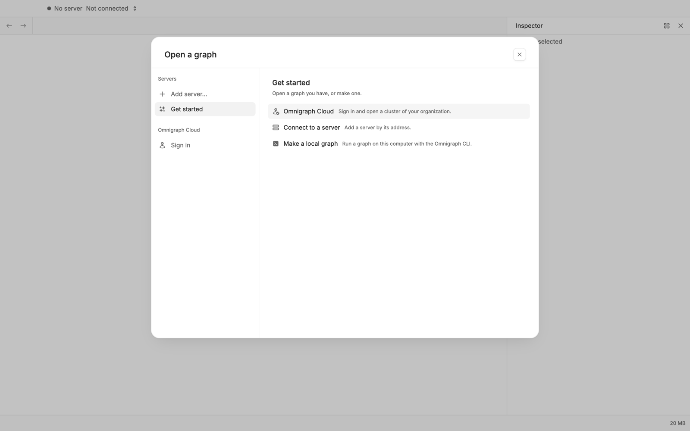
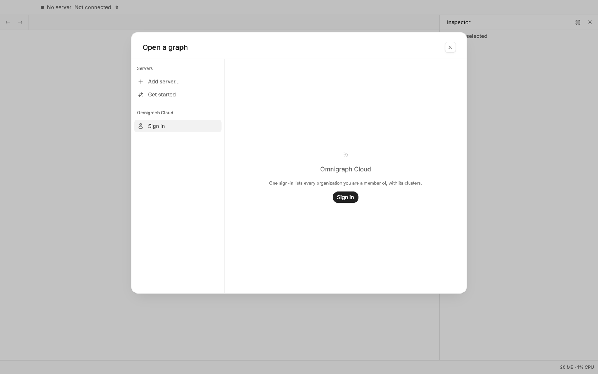
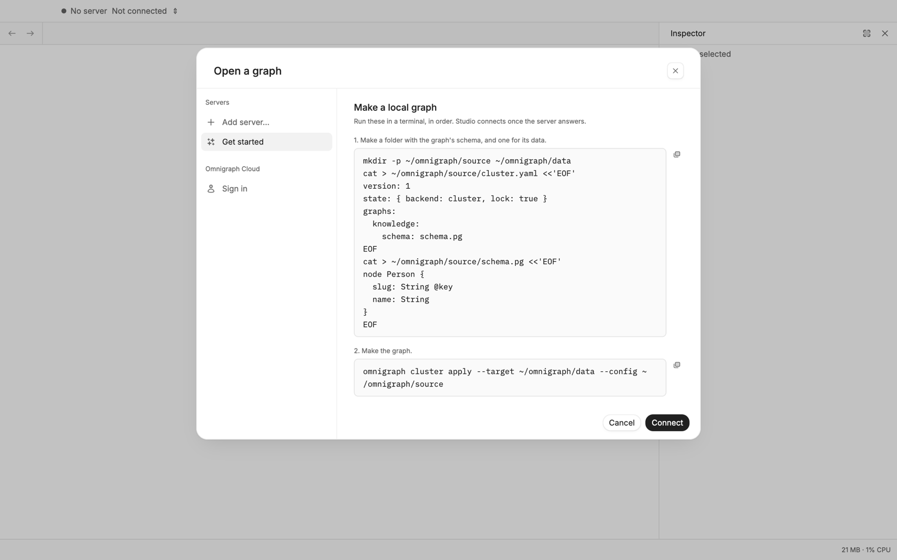
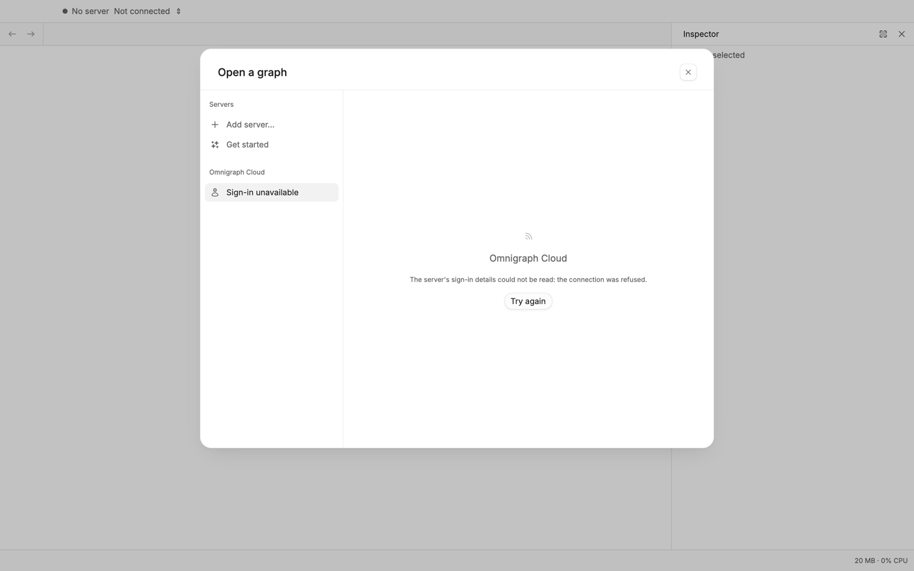
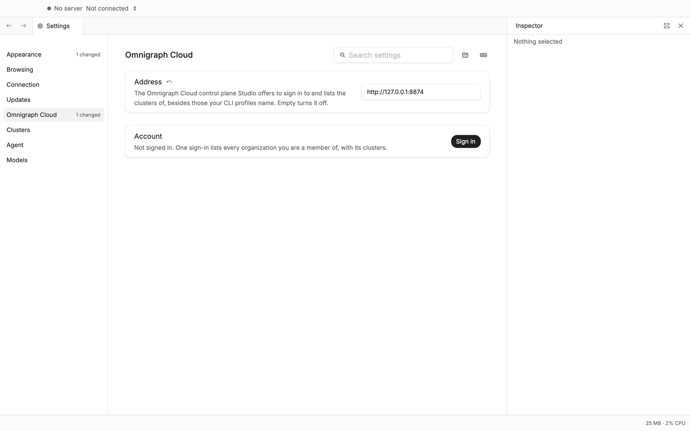
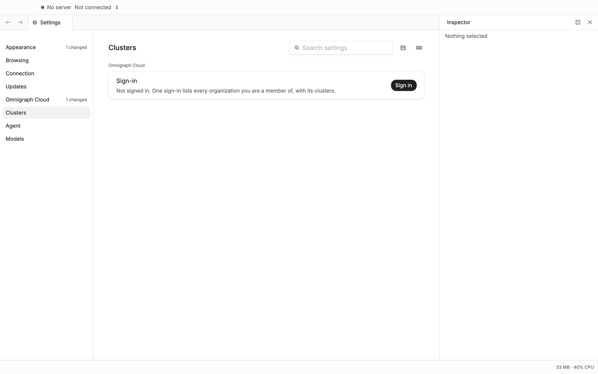
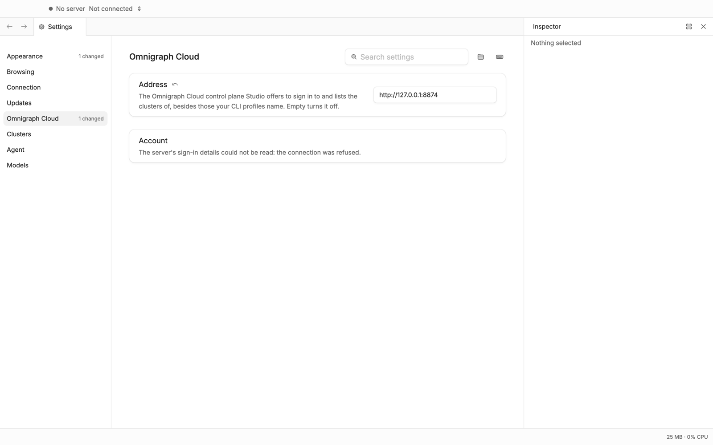
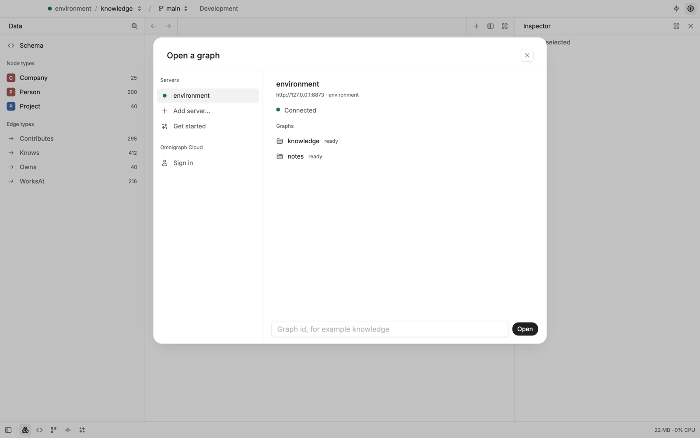

# Studio without Omnigraph Cloud, and the Cloud waitlist

A design study, 21 November 2026. No product code changes here. It records what a person without
Omnigraph Cloud sees in Studio today, and proposes how Studio can point people to the Cloud
waitlist without pushing them.

Studio at `74eedf31` (main, 0.4.11). Principles touched: I (outside requests), VI (every control
explains itself), VII (loudness matches cost), VIII (keyboard first). Privacy: [privacy.md](../privacy.md)
and [telemetry.md](../telemetry.md).

## How the screenshots were made

Offscreen, with `crates/studio/examples/snapshot.rs` at 1280×800:

- `OMNIGRAPH_HOME` set to an empty folder, so the CLI lists no targets and no profiles, as for a
  new person.
- `OMNIGRAPH_STUDIO_DATA` set to an empty folder holding one setting:
  `omnigraph_cloud` = `http://127.0.0.1:8874`, a port where nothing listens. This keeps Studio from
  reading a kept Cloud sign-in from this machine's keychain, so no real control plane was called.
  The plane still counts as Omnigraph Cloud (`is_default`), so every screen draws as it would for
  `https://platform.omnigraph.dev`. Two side effects show in the images: the Address field holds the
  stand-in address, and Settings marks the section "1 changed".
- The local user's screens use `script/dev-server` on `127.0.0.1:8873` with its default seed.

| | |
|---|---|
|  01 Get started, first run |  02 The Cloud pane |
|  03 Make a local graph |  04 Sign-in unavailable, dialog |
|  05 Settings → Omnigraph Cloud |  06 Settings → Clusters |
|  07 Sign-in unavailable, Settings |  08 A local server's dialog |

States that need a real Cloud account (signed in with no organization, an organization with no
clusters, the web sign-in itself) are traced in code and marked so.

## What a person without Cloud sees today

### Worst dead ends first

1. **Signing in without an invitation ends at the wrong advice.** The start screen's Cloud row reads
   "Sign in and open a cluster of your organization." ([01](2026-11-21-cloud-onboarding/01-get-started.png)),
   and its pane says "One sign-in lists every organization you are a member of, with its clusters."
   with one button, Sign in ([02](2026-11-21-cloud-onboarding/02-cloud-sign-in.png)). Nothing says
   Cloud is in private preview, or that access comes by invitation from a waitlist. A person who signs
   in anyway, and whom the sign-in service lets through without an organization, gets the
   **No organizations** state: "You are signed in as ACCOUNT, but no organization has you as a member.
   Ask an owner of one to invite you, then Refresh." (`crates/studio/src/organizations.rs:394-411`).
   For nearly everyone without Cloud there is no owner to ask. Settings → Clusters says only "You are
   a member of no organization here." (`crates/studio/src/cloud_settings.rs:251-254`), with no next
   step at all. *Traced in code; whether the sign-in service lets an uninvited person through, or
   refuses them on the web, can only be seen against the real Cloud.*
2. **An organization with no clusters is a shrug.** The dialog shows an empty state "No clusters"
   and nothing else (`organizations.rs:533-537`); Settings → Clusters says "No clusters in this
   organization." (`cloud_settings.rs:355`). The CLI has `omnigraph cluster create`, and constitution
   VI asks Studio to show it. *Traced in code.*
3. **A failed sign-in in Settings has no way to try again.** In the dialog, "Sign-in unavailable"
   has Try again ([04](2026-11-21-cloud-onboarding/04-sign-in-unavailable.png)); in Settings → Omnigraph
   Cloud the same state draws no control (`cloud_settings.rs:470`), so the row stays as it is until
   Studio restarts ([07](2026-11-21-cloud-onboarding/07-settings-unavailable.png)). The reason also
   calls the control plane "the server": "The server's sign-in details could not be read: the
   connection was refused."
4. **Cloud is turned off and the dialog only says so.** With `omnigraph_cloud` empty, the Cloud row
   says "Omnigraph Cloud's address is not set. Set it in Settings → Omnigraph Cloud."
   (`crates/studio/src/open_graph.rs:775-781`): a path to describe, not a link to follow. *Traced in
   code.*
5. **Nothing in Studio says what Omnigraph Cloud is.** The name appears in six places (below) and
   always as a place to sign in. No screen, menu or link explains it, and Studio links to
   omnigraph.dev nowhere: the Help menu has Keyboard Shortcuts and Reveal Log File
   (`crates/studio/src/menus.rs:104-107`), and the About window has the icon, name, version, copyright
   and licence (`crates/studio/src/about.rs`).

### By case

**First run, no CLI targets, no Cloud account.** Studio opens on "No graph open" with Open a graph.
The Open dialog starts on Get started with three rows: Omnigraph Cloud, Connect to a server, Make a
local graph ([01](2026-11-21-cloud-onboarding/01-get-started.png)). The sidebar already lists an
"Omnigraph Cloud" section with one row, "Sign in". Cloud is first, and ↵ takes it. Nothing is sent to
the control plane until Sign in is pressed (spec 021).

**Choosing Cloud without an account.** ↵ moves to the plane's pane, Sign in ([02](2026-11-21-cloud-onboarding/02-cloud-sign-in.png)).
Sign in reads the control plane's sign-in details, then opens the browser and waits ("Finish signing
in at HOST in your browser." with Cancel) for at most five minutes
(`crates/graph_store/src/sign_in.rs:891`), after which it offers Sign in again with "The sign-in was
not finished within five minutes." A refusal on the web comes back as the service's words in the same
pane. A sign-in that succeeds with no organization is dead end 1. When the details cannot be read, the
row becomes "Sign-in unavailable" with Try again ([04](2026-11-21-cloud-onboarding/04-sign-in-unavailable.png)).

**An account with an organization but no clusters, or no access yet.** Dead end 2. A cluster that is
still provisioning, or has data access off, shows dimmed with "Provisioning" or "No data endpoint"
(`organizations.rs:140-150`). A 403 reads "Your role in ORGANIZATION does not allow this", with the
control plane's detail.

**A person who only uses local or self-hosted servers.** They see their servers, Get started, and an
Omnigraph Cloud section with a muted "Sign in" row in every Open dialog
([08](2026-11-21-cloud-onboarding/08-local-user-dialog.png)). Nothing else in the window mentions
Cloud. The local recipe (Make a local graph) is four commands to copy, ending with a server they keep
running in a terminal ([03](2026-11-21-cloud-onboarding/03-local-recipe.png)); it says nothing of a
hosted alternative.

**Settings.** Two sections: **Omnigraph Cloud** holds the Address ("The Omnigraph Cloud control plane
Studio offers to sign in to and lists the clusters of, besides those your CLI profiles name. Empty turns
it off.") and an Account row, "Not signed in. One sign-in lists every organization you are a member of,
with its clusters." with Sign in ([05](2026-11-21-cloud-onboarding/05-settings-cloud.png)).
**Clusters** repeats the sign-in under an "Omnigraph Cloud" heading ([06](2026-11-21-cloud-onboarding/06-settings-clusters.png)).
With Cloud off: "Omnigraph Cloud is off. Set its address above to sign in."

**Loading states.** "Reading the control plane's sign-in…", "Keeping the sign-in in your keychain…",
"Reading your organizations…", "Reading its clusters…". All are bounded (10 s reads, the five-minute
browser wait), and none hangs: spec 029 fixed the read that never ended on an empty list.

### Every place Studio names Omnigraph Cloud

| Where | Text |
|---|---|
| Get started, first row | "Omnigraph Cloud" · "Sign in and open a cluster of your organization." |
| Get started sidebar row tooltip | "Omnigraph Cloud, a server by its address, or a graph on this computer" |
| Open dialog sidebar | the "Omnigraph Cloud" section and its sign-in row |
| The plane's pane | "Omnigraph Cloud" over the sign-in |
| Cloud row with the setting empty | "Omnigraph Cloud's address is not set. Set it in Settings → Omnigraph Cloud." |
| Settings | the "Omnigraph Cloud" section, its Address description, and the heading on Clusters |

### Where it could, and does not

- The start screen and the sign-in pane: what Cloud is, that it is in private preview, and how access
  is granted.
- No organizations: the waitlist, which is how an uninvited person gets in.
- The local recipe: the hosted alternative to keeping a server running yourself.
- Help menu and About: a link to Omnigraph's site or docs. There is none of any kind today.
- README: it does not name Cloud.

## What the brand says

From `ModernRelay/brand` (its product site, `apps/omnigraph`, and the shared design system). Only
public site copy is quoted, in short phrases.

- **Status.** Cloud is in "private preview · waitlist", and the waitlist is the way in:
  "Invitations go out from this list." Studio must not imply anyone can sign in and get a cluster.
- **What Cloud is.** A dedicated cluster per organisation, managed upgrades and backups, and a
  control plane with SSO, scoped tokens, policy and audit. The site has a pitch line for it; Studio
  does not repeat it, or any other benefit slogan (see Copy, below).
- **Voice.** Plain and literal: headings say what the section holds, no slogans. That is Studio's
  voice too. Studio keeps its own spelling ("organization").
- **Promises Studio should not repeat.** The site's copy is marked draft until signed off, and it
  states preview pricing. Studio links to the page instead of restating price, dates or features, so
  it never says more than the site does.
- **Where the waitlist is joined.** `https://www.omnigraph.dev/cloud`, whose form sits at `#join`.
  The site also has the form on its home page. Submitting sends a confirmation email; nothing is
  stored until the link in it is clicked (double opt-in). One message to confirm, then mail only
  about Cloud access, with news only if the person ticks a box.
- **What the site counts.** Its public privacy notice says it counts page views with the page
  address (cookieless analytics) and two events, a waitlist submission and a confirmation. The
  submission event carries which form was used (hero, section, page, home news). The site does not
  read `utm_*` or any other source parameter today.
- **The form is not an API.** It posts to the site's own server-side form handler, built with the
  site, not to a public, versioned endpoint. Studio cannot submit it reliably from outside the page.

## Proposal

### Principles

1. **Answer, don't advertise.** The waitlist appears only where the person is already looking at
   Cloud, or where Studio would otherwise leave them stuck. No badge, banner, modal or count of
   sessions. The one toast is the Copy Link note for a server on this computer (touchpoint 7),
   which says a fact the person needs first.
2. **The browser does the asking.** Studio opens the site's Cloud page; the person types their email
   there. Studio sends nothing, stores no email and makes no new request (constitution I is
   unchanged: opening the browser is not a request of Studio's).
3. **Say only what the site says.** "Private preview", "invitations go out from the waitlist".
   Anything more is a link.
4. **Gone once it is moot.** Every waitlist line disappears while Studio holds an Omnigraph Cloud
   sign-in that lists an organization, while `omnigraph_cloud` is empty, and while it names
   another address than Omnigraph Cloud's own.

### Copy

Studio's Cloud copy is factual, never promotional. It states the fact and the action, for example
"Omnigraph Cloud is in private preview. Invitations go out from the waitlist." with "Join the
waitlist ↗", or "No organization has you as a member yet." It has no rhetorical question, no
pitch line or benefit slogan ("managed for you", "runs it for you"), no exclamation mark and no
urgency. An earlier draft of this study had such lines; they are gone.

### The link

```
https://www.omnigraph.dev/cloud?utm_source=omnigraph-studio&utm_medium=app&utm_content=<surface>#join
```

`<surface>` is one of `get-started`, `sign-in`, `no-organizations`, `sidebar`, `settings`,
`copy-link`, `help`, `about`, `local-recipe`. The query is constant text: no version, no ID,
nothing about the person or their graphs. It lives in one constant beside `OMNIGRAPH_CLOUD` in
`studio_settings`, and the surfaces are an enum, so a test can check every link and that none
carries anything else.

One action, `studio::JoinCloudWaitlist`, opens it from the Help menu and the palette as "Join the
Omnigraph Cloud Waitlist". AGENTS.md asks every action for a default binding, and it has one, a
chord no one hits by accident (⌘⌥⇧J). It follows the same rule: disabled in the menu and absent
from the palette where the waitlist is not offered.

### The touchpoints, in order

**1. Get started, the Cloud row and its pane.** The row says what Cloud is today, and the pane
offers both ways in. This is the first run with no server, and the one place everyone passes.

```
Get started
Open a graph you have, or make one.

 [◎] Omnigraph Cloud      In private preview.              Join the waitlist ↗
 [▤] Connect to a server  Add a server by its address.
 [>] Make a local graph   Run a graph on this computer with the Omnigraph CLI.
```

```
                         Omnigraph Cloud
   Omnigraph Cloud is in private preview. Invitations go out from the
   waitlist. Once invited, sign in to open your organization's clusters.

                 ( Sign in )   Join the waitlist ↗
```

Sign in stays the primary button and keeps ↵: invited people must not be slowed. "Join the waitlist"
is a link-styled button with an external-link icon, tooltip "Opens omnigraph.dev in your browser".
Surface `get-started` for the row, `sign-in` for the pane.

**2. No organizations.** For the Omnigraph Cloud plane only (another control plane keeps today's
words):

```
                         Omnigraph Cloud
   Signed in as ACCOUNT. No organization has you as a member yet.
   Omnigraph Cloud is in private preview. An owner of an organization can
        invite you, and invitations go out from the waitlist.

          ( Join the waitlist ↗ )   ( Refresh )   ( Sign out )
```

Here the waitlist is the primary next step, because it is the only one most people have. Settings →
Clusters gets the same sentence and a "Join the waitlist" row button in place of "You are a member of
no organization here." Surface `no-organizations`.

**3. Settings → Omnigraph Cloud, Account row, signed out.**

```
Account                              Join the waitlist ↗   ( Sign in )
Not signed in. Omnigraph Cloud is in private preview. Invitations go
out from the waitlist.
```

The link sits beside Sign in, which stays the primary button. Surface `settings`. The same change
gives "Sign-in unavailable" its Try again here (dead end 3).

**4. The local recipe, one line under its steps.**

```
4. Start the server, and leave it running.
   omnigraph-server --cluster ~/omnigraph/data --bind 127.0.0.1:8787 …

Omnigraph Cloud: private preview · Join the waitlist ↗
                                                  ( Cancel ) ( Connect )
```

Muted text, below the steps and above nothing that matters; it never moves Connect. Nothing else,
and no question. Surface `local-recipe`.

**5. Help menu and palette.** "Join the Omnigraph Cloud Waitlist" under Help and in the palette,
with its binding. Surface `help`. This is where people who want it later will look.

**6. The Open dialog's sidebar, Omnigraph Cloud's row, signed out.** A muted second line under
"Sign in": "Private preview · Join the waitlist ↗". Surface `sidebar`.

**7. Copy Link to a server on this computer.** A link to `127.0.0.1`, `localhost` or `[::1]`
opens nowhere else, so Copy Link says so in a toast: "This link opens only on this Mac." with
"Omnigraph Cloud: private preview" and Join the waitlist while the waitlist is offered. A server
others reach gets no toast, as before. Surface `copy-link`.

**8. About.** One line under the version: "Omnigraph Cloud: private preview · Join the waitlist ↗".
Surface `about`.

### Rejected

| Candidate | Why not |
|---|---|
| After N local sessions | Needs Studio to count sessions to market to the person, and is a nag by design. |
| When a local graph grows | No size means "needs Cloud"; reading sizes for marketing is work Studio should not do. |
| Cloud-only features (backups, sharing, access control, hosted agents) | Studio has no such gate: Cedar policy, branches and the agent panel work on any server. Inventing locked features to sell Cloud would be dishonest. |
| In-app release notes | Studio has none; GitHub release notes are the brand's call, not the app's. |
| An in-app email form | See below. |

### Why not a form inside Studio

It would make Studio send a person's email to a server, a new kind of outside request: constitution
I would need an amendment naming the one crate that makes it, and privacy.md would need a new
section. It also has nowhere stable to send to: the site's form posts to its own server-side handler,
not a public endpoint, so a Studio form would break with the site's next deploy. If it is ever
wanted, it needs, first, a public and versioned endpoint on the site (`POST` with exactly `email`,
the news opt-in and `source=studio`), and in Studio a form that sends only on the person's Submit,
says before Submit where it goes and that a confirmation email follows, and keeps nothing. The page
already does all of this, with the site's own privacy link beside the field, so the link is the
better design.

### Frequency, dismissal and special cases

- **No frequency to manage.** Each touchpoint is part of a screen the person opened, or, for
  Copy Link, follows what they just did. Nothing appears on a timer or on launch, so there is
  nothing to snooze.
- **No dismissal needed, and none faked.** The lines are static and small; a close button on them
  would imply they come back. If one is ever made more prominent (a band, a card), it gets a close
  button whose choice Studio keeps in its data folder forever, and never shows again.
- **Already on the waitlist.** Studio cannot know, and should not ask. The words "invitations go out
  from the waitlist" read correctly for someone already on it, and the site handles a second signup.
- **Already in Cloud.** A held Omnigraph Cloud sign-in with at least one organization removes every
  touchpoint. A person signed out of Cloud sees touchpoints 1 and 3, which still begin with Sign in.
- **Cloud turned off** (`omnigraph_cloud` empty, as an admin might ship it), or pointed at another
  address: no touchpoint at all; Help's item is disabled.
- **Offline.** Studio checks nothing before opening the link; the browser shows its own offline page.
  Studio never fetches the site, so offline costs nothing and leaks nothing.
- **Another control plane** named by a CLI profile: no waitlist on its panes. The waitlist is
  Omnigraph Cloud's alone.

### Measuring it

- **Studio counts nothing.** It has had no telemetry since 0.4.7, and this proposal adds none:
  reintroducing a report needs telemetry.md to list it before any release sends it, which is out of
  proportion for a link.
- **The site counts it.** The `utm_*` query arrives as part of the page address, which the site's
  page-view analytics already record. To count signups, not only visits, the site needs one small
  change in the brand repo: read `utm_source=omnigraph-studio` (and `utm_content`) on `/cloud` and pass
  `studio` as the form's source in the submission event, beside today's hero, section, page and home
  news. Without it, Studio's visits are measurable and its signups are not.
- **Privacy.md gets one sentence**, under Requests Studio makes for itself: "Join the waitlist opens
  omnigraph.dev in your browser, with the place in Studio you clicked it in the address. Studio sends
  nothing itself." The site's own privacy notice covers the rest.

### Order of work

1. **Fix the dead ends** (no marketing): Try again in Settings when sign-in is unavailable; "the
   control plane", not "the server", in its reason; "No clusters" shows `omnigraph cluster create`;
   the empty-address message links to the setting.
2. **Touchpoints 1 to 8**, through one module for the rule, text and link, with the action, the
   link constant and its test, and the privacy.md sentence. Built in #164 (spec 047).
3. **The brand-repo change** so the site attributes signups to Studio.
4. **An "Omnigraph Website" Help item**, if wanted.

## What this study could not check

- What the sign-in service does with a person who has no invitation: lets them through with no
  organization (dead end 1), or refuses them on the web. Seeing it needs a real account.
- The No organizations and No clusters screens, which need a control plane that answers; both are
  traced in code above.
- The About window and menus, which the offscreen snapshot does not draw; read from code.
- Whether each analytics tool on the site breaks visits out by `utm_*`; the address reaches them, but
  that is a question for their dashboards.
